# Dependabot Backlog Agent — Technical Spec v9

**Event:** neatHack (neatlogs), build 10–11 Oct 2026, submit 12 Oct 2026, 7:00–11:55 PM IST
**Codename:** `dba`
**Status:** Design spec. No code is written before kickoff (10 Oct, 12:30 PM IST).
**Scope:** Python repos (pip / uv / Poetry lockfiles), pytest suites, GitHub.

Items marked **[VERIFY]** depend on a platform detail to confirm at kickoff. All of them are collected in section 31 with a check and a fallback.

---

## 0. What changed

### v8 → v9: open-weight models
| Area | v8 | v9 |
|---|---|---|
| Models | Claude Haiku/Sonnet-class on Bedrock | **Open-weight models on Bedrock**: GLM-5.3 as `orchestrator`, an open "Sonnet-class" `coder` chosen by bake-off, GLM 4.7 Flash as `light` (section 19) |
| API | Anthropic Messages via `AsyncAnthropicBedrock` | **OpenAI-compatible Chat Completions** via the `openai` SDK and a Bedrock API key; provider-neutral |
| Tool calling | Anthropic tool-use blocks | OpenAI function calling with schema validation and repair turns (section 19.3) |
| `llm-gateway` | Anthropic Messages proxy | OpenAI-compatible proxy with model aliases |
| OpenCode | `amazon-bedrock` / Anthropic provider | OpenAI-compatible custom provider (gateway in sandboxes, Bedrock endpoint in devbox) |
| Alternate reviewer | Claude Code on Bedrock | Second OpenCode reviewer on a different open model |

### v7 → v8: Google sign-in in front of Temporal UI
| Area | v7 | v8 |
|---|---|---|
| Temporal UI access (server) | Caddy basic auth | **oauth2-proxy with Google sign-in**, restricted to an email allowlist (section 3.7) |
| Temporal UI exposure | Port published on laptop, behind Caddy on servers | Only reachable through oauth2-proxy on servers; Temporal gRPC (`7233`) never published |

### v6 → v7: Next.js + shadcn UI, motion, Laws of UX
| Area | v6 | v7 |
|---|---|---|
| Frontend | React + Vite, served by FastAPI | **Next.js App Router** as its own `web` service |
| Components | Unspecified | **shadcn/ui first**; compose from shadcn when missing; custom only as a justified last resort (section 16.5) |
| Styling / icons | Tailwind | **Tailwind** with shadcn theme tokens; **lucide-react** icons only |
| Motion | — | Transition and animation system for every interaction (section 16.6) |
| UX rules | — | All 30 Laws of UX mapped to concrete rules and screens (section 16.7) |
| Routing | Separate ports on laptop | **Caddy in the base compose** for same-origin routing (`localhost:8080` on laptops, HTTPS on servers) |
| Dev Console UI | FastAPI page | Page in the Next.js app (`/admin/devconsole`) backed by a small devconsole API in the devbox |

### v5 → v6: portable Docker Compose project, SQLite
| Area | v5 | v6 |
|---|---|---|
| Deployment target | AWS-specific (CloudFormation, ECR, SSM, OIDC, two EC2 instances) | **One Docker Compose project** that runs unchanged on a laptop, an EC2 instance or any Linux server |
| Cloud IAM in code | Instance roles, STS for sandboxes, Secrets Manager | **None.** Credentials come from `.env` and `secrets/`; nothing in the code manages cloud identities |
| App database | Postgres | **SQLite** (WAL mode) at `data/dba.sqlite3`, via SQLAlchemy async + `aiosqlite`; schema kept portable so Postgres is a URL change later |
| Live updates | Postgres `LISTEN/NOTIFY` | SSE endpoint polls the indexed `events` table (500 ms) |
| Evidence store | S3 | Local directory `data/blobs/` (volume) |
| Sandbox model access | STS Bedrock-only credentials | **`llm-gateway` service**: sandboxes get a short-lived per-attempt token; the gateway holds the Bedrock credentials and records usage |
| Dev environment | `dba-dev` EC2 instance | **`devbox` compose service** (profile `devbox`): OpenCode Web + Dev Console + Entire, on the laptop or the server |
| HTTPS / auth on servers | Caddy on two instances | `compose.server.yml` overlay adds Caddy (auto TLS, basic auth); not used on the laptop |
| Deploy | GitHub Actions → ECR → SSM | `git pull` + `docker compose up -d --build` on the host; optional generic GitHub Actions job over SSH |

Bedrock is still used for every model call; it is accessed with an API key from `.env`, like any other API.

### Earlier versions (summary)
- **v5:** browser-only operation (OpenCode Web, Dev Console, Ops page); Entire remote device login; checkpoint refs corrected to `refs/entire/checkpoints/*`; telemetry prompt avoided in containers.
- **v4:** everything off the laptop (replaced in v6 by "anywhere Docker runs").
- **v3:** Bedrock for all model calls; OpenCode fixer captured by Entire; dedicated orchestration and harness sections.
- **v2:** web app, Temporal workflows, GitHub App, PR action levels with approvals, cfo.ai via MCP, extended neatlogs/Entire usage.
- **v1:** CLI agent design.

---

## 1. Product definition

### 1.1 Goal
A user connects a GitHub repository. The system works through its backlog of open Dependabot pull requests unattended and ends each one with **a verdict plus checkable evidence**, then performs (or proposes) the matching GitHub action.

| Verdict | Meaning | Required evidence |
|---|---|---|
| `MERGE` | Bump applies cleanly, tests pass, no reachable breaking change | Test run, usage report |
| `FIX_THEN_MERGE` | Bump broke repo code; agent patched it; tests pass | Failing run, patch diff, passing run, Entire checkpoint of the fix session, review result |
| `DISMISS` | Safe to close, with a reason code | Reason-specific evidence |
| `NEEDS_HUMAN` | No confident verdict within budget | What was tried, why it stopped |

`DISMISS` reason codes: `SUPERSEDED` (newer open PR for the same package) · `UNREACHABLE_AND_BREAKING` (changed/vulnerable code unreachable, bump breaks repo, not worth fixing now) · `DEV_ONLY_NO_IMPACT` (dev/test-only dependency, unused).

**Hard rule:** a security update whose vulnerable code is `REACHABLE` or `UNCERTAIN` is never `DISMISS`.

### 1.2 Users
- **Maintainer:** installs the GitHub App, runs backlogs, approves actions.
- **Visitor:** pastes a public repo URL for a read-only analysis. No code execution, no writes.
- **Admin (Hiten):** runs evals, compares prompt versions, exports economics.

### 1.3 Non-goals
No writes where the App is not installed · Python only · not a Dependabot replacement · no claim of sound reachability (uncertainty → `NEEDS_HUMAN`).

---

## 2. System overview

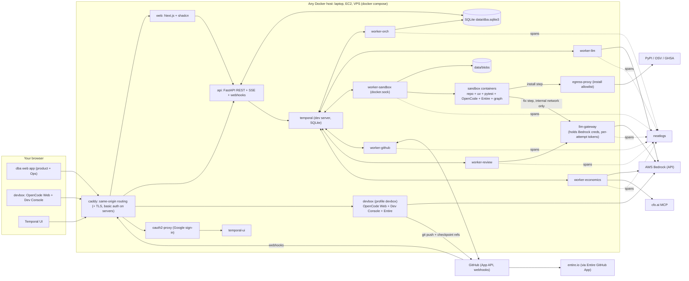

Caddy runs everywhere for same-origin routing; on a laptop it serves plain HTTP on `localhost:8080`, on servers it adds TLS and basic auth (section 3).

### 2.1 Platform communication

| Platform | Used for | Mechanism | Credentials (from `.env` / `secrets/`) |
|---|---|---|---|
| GitHub | Read PRs; push fixes; comment, label, close, merge; webhooks | GitHub App REST API (`httpx` async) | App ID + private key file `secrets/github-app.pem`; installation tokens minted per activity |
| AWS Bedrock | **All model calls** (open-weight models) | OpenAI-compatible Chat Completions via `AsyncOpenAI` in `worker-llm`, `worker-economics`, `llm-gateway`; OpenCode in devbox via an OpenAI-compatible provider; sandboxes and reviewers only through `llm-gateway` | `BEDROCK_API_KEY`, `LLM_BASE_URL` |
| PyPI / OSV / GHSA | Package sources, advisories | JSON APIs; `pip download` via egress proxy | none / App token |
| neatlogs | Traces, prompts, detections, evaluators, analytics | `neatlogs` SDK in every Python service | `NEATLOGS_API_KEY` |
| Entire | Checkpoints (build + fixer sessions), graph, review, dispatch | CLI in devbox, sandbox and review images | Device login only where needed (section 22.0) |
| OpenCode | Your coding agent (devbox, web UI); fixer (sandbox); cfo.ai sync agent (economics) | `opencode web` / `opencode run` | Bedrock creds (devbox, economics); gateway token (sandbox) |
| cfo.ai | Business model | MCP `https://api.cfo.ai/mcp` from `worker-economics` | One-time OAuth, state on `data/opencode-economics` **[VERIFY]** |
| X | Submission + building in public | Manual | — |

The only cloud-side setup is enabling model access and creating a Bedrock API key once in the AWS Console. No code creates or uses cloud roles.

---

## 3. Running and deploying with Docker Compose

The same repository and compose files run on a laptop for testing and on any Linux server (EC2, VPS, bare metal) for the demo. Nothing is cloud-specific.

### 3.1 Services

| Service | Build | Role | Ports (laptop) | Volumes | Profile |
|---|---|---|---|---|---|
| `web` | `docker/Dockerfile.web` (Next.js standalone) | UI (App Router, shadcn) | internal (`3000`) | — | default |
| `api` | `docker/Dockerfile.app` | FastAPI JSON API + SSE + webhooks | internal (`8000`) | `./data` | default |
| `temporal` | `temporalio/temporal` CLI image, `server start-dev --db-filename /data/temporal.db` | Workflow engine | `7233` (internal) | `./data/temporal` | default |
| `temporal-ui` | official UI image | Debug workflows | laptop `127.0.0.1:8233`; server: none (internal only) | — | default |
| `oauth2-proxy` | `quay.io/oauth2-proxy/oauth2-proxy` (pinned tag) | Google sign-in in front of Temporal UI | internal (`4180`) | `./secrets/temporal-allowed-emails.txt` (ro) | server overlay; laptop profile `auth` for testing |
| `worker-orch` | `Dockerfile.app` (`--queue orch`) | Workflows + light activities | — | `./data` | default |
| `worker-llm` | `Dockerfile.app` (`--queue llm`) | Bedrock calls | — | `./data` | default |
| `worker-sandbox` | `Dockerfile.app` (`--queue sandbox`) | Creates and drives sandbox containers | — | `./data`, `/var/run/docker.sock` | default |
| `worker-github` | `Dockerfile.app` (`--queue github`) | All GitHub writes and reads | — | `./data`, `./secrets` (ro) | default |
| `worker-review` | `docker/Dockerfile.review` (`--queue review`) | `entire review`, Entire login job | — | `./data`, `./data/entire-auth` | default |
| `worker-economics` | `docker/Dockerfile.review` (`--queue economics`) | cfo.ai sync via OpenCode | — | `./data`, `./data/opencode-economics` | default |
| `llm-gateway` | `Dockerfile.app` (`gateway` entrypoint) | Bedrock proxy for sandboxes and reviewers (section 19.5) | internal only | `./data` | default |
| `egress-proxy` | small Squid/tinyproxy image | Allowlisted egress for sandbox install steps | internal only | config | default |
| `sandbox` image | `docker/Dockerfile.sandbox` | Built by compose (`build` only, never started by compose) | — | — | `build` |
| `devbox` | `docker/Dockerfile.devbox` | OpenCode Web + devconsole API + Entire for your build sessions | `4096` (OpenCode Web); devconsole API internal (`4097`, via Caddy `/devbox-api`) | `./data/workspace`, `./data/entire-auth`, `./data/opencode-dev` | `devbox` |
| `caddy` | official image | Same-origin routing (`/` → web, `/api` `/auth` `/webhooks` → api, `/devbox-api` → devbox); TLS + basic auth on servers | laptop `127.0.0.1:8080`; server `80`, `443` | `./data/caddy` | default (`Caddyfile.local`); server overlay swaps to `Caddyfile.server` |

Docker networks: `app` (all services), `sandbox-install` (sandboxes ↔ egress-proxy), `sandbox-llm` (sandboxes ↔ llm-gateway, `internal: true`, no internet).

### 3.2 Files

```
docker-compose.yml        # all services above
compose.server.yml        # switches caddy to Caddyfile.server (TLS, basic auth), restart policies
.env.example              # copy to .env
secrets/github-app.pem    # GitHub App private key (gitignored)
secrets/temporal-allowed-emails.txt   # one Google account email per line (gitignored)
Caddyfile.local           # http://localhost:8080 routing
Caddyfile.server          # dba.<domain>, dev.<domain> (TLS + basic auth), temporal.<domain> (TLS → oauth2-proxy)
config.toml               # models, limits, fixer mode, review, actions
data/                     # gitignored: dba.sqlite3, temporal/, blobs/, workspace/, entire-auth/, opencode-*/
```

`.env.example`:
```dotenv
# Models (Bedrock, OpenAI-compatible)
LLM_BASE_URL=                        # Bedrock OpenAI-compatible endpoint for your Region
BEDROCK_API_KEY=
# GitHub App
GITHUB_APP_ID=
GITHUB_APP_CLIENT_ID=
GITHUB_APP_CLIENT_SECRET=
GITHUB_WEBHOOK_SECRET=
GITHUB_APP_KEY_FILE=/secrets/github-app.pem
CHECKPOINT_REPO=hiten/dba-checkpoints
CHECKPOINT_REPO_TOKEN=               # fine-grained token, that repo only
# devbox git push
DEVBOX_GITHUB_TOKEN=                 # fine-grained token for hiten/dba
DEVBOX_REPO_URL=https://github.com/hiten/dba.git
OPENCODE_SERVER_PASSWORD=
# neatlogs
NEATLOGS_API_KEY=
# app
DATABASE_URL=sqlite+aiosqlite:////data/dba.sqlite3
SESSION_SECRET=
GATEWAY_SIGNING_KEY=
PUBLIC_BASE_URL=http://localhost:8080
# server only
DOMAIN=
BASIC_AUTH_USER=
BASIC_AUTH_HASH=
# Google sign-in for Temporal UI (oauth2-proxy)
OAUTH2_PROXY_CLIENT_ID=
OAUTH2_PROXY_CLIENT_SECRET=
OAUTH2_PROXY_COOKIE_SECRET=          # random 32 bytes, base64
OAUTH2_PROXY_REDIRECT_URL=https://temporal.<domain>/oauth2/callback
```

### 3.3 Laptop (testing)

| Item | Value |
|---|---|
| Requirements | Docker Desktop or Docker Engine with Compose v2; 4+ CPU, 16 GB RAM recommended; macOS (arm64) or Linux |
| Start | `docker compose --profile devbox up -d --build` (or the Docker Desktop UI) |
| Open | dba app `http://localhost:8080` (Dev Console at `/admin/devconsole`) · OpenCode Web `http://localhost:4096` · Temporal UI `http://localhost:8233` |
| Concurrency | `limits.concurrency = 1` in `config.toml` |
| GitHub App | Add `http://localhost:8080/auth/callback` as a callback URL (GitHub Apps accept several) |
| UI development | `web` can also run with `next dev` (hot reload) via `docker compose -f docker-compose.yml -f compose.dev.yml up web`, still behind Caddy |
| Webhooks | Optional on laptop. Continuous mode needs a tunnel (e.g. smee.io or Cloudflare Tunnel) to `/webhooks/github`; backlog runs work without webhooks |
| Ports | Bound to `127.0.0.1` only |

### 3.4 Server (EC2 or any Linux host)

| Item | Value |
|---|---|
| Size | 8 vCPU / 32 GB / 100 GB disk for 3 parallel sandboxes |
| OS | Any Linux with Docker Engine + Compose v2 |
| Firewall | 80 and 443 in; everything else closed |
| DNS | `dba.<domain>`, `dev.<domain>`, `temporal.<domain>` → server IP |
| Start | `docker compose -f docker-compose.yml -f compose.server.yml --profile devbox up -d --build` |
| TLS | Caddy obtains certificates automatically |
| Auth | `temporal.`: Google sign-in via oauth2-proxy (allowlisted emails); `dev.`: Caddy basic auth + `OPENCODE_SERVER_PASSWORD`; dba app: GitHub sign-in |
| Update | `git pull && docker compose -f docker-compose.yml -f compose.server.yml up -d --build` (or the optional GitHub Actions job `deploy-ssh.yml` that runs the same over SSH) |
| Backups | Copy `data/` (SQLite via its online backup API in a small script; Temporal SQLite file while stopped or via snapshot) |

Rebuilding and restarting during a run is safe: Temporal resumes in-flight workflows on the restarted workers.

### 3.5 Laptop vs server

| Concern | Laptop | Server |
|---|---|---|
| Caddy | HTTP routing on `localhost:8080` | TLS + basic auth (`compose.server.yml`) |
| Sandboxes in parallel | 1 | 3 |
| Webhooks / continuous mode | Optional (tunnel) | On |
| Public analysis mode | Off | On, rate-limited |
| devbox | Optional (you may also code locally) | On, behind basic auth |
| Data | `./data` on laptop | `./data` on server disk |

### 3.6 Web-only operation

| You want to | Where (browser) | Behind it |
|---|---|---|
| Write code | OpenCode Web (devbox) | OpenCode with Bedrock; Entire captures sessions; you ask OpenCode to commit and push |
| Entire login, enable, status, checkpoints | dba web app → Admin → Dev Console | devconsole API in devbox runs section 22 commands |
| Watch runs, approve actions | dba web app | Product UI |
| Health, evals, economics, integrations | dba web app → Ops | Admin-only pages |
| Debug workflows | Temporal UI (`temporal.<domain>`, Google sign-in) | oauth2-proxy → temporal-ui |
| Checkpoints and sessions | entire.io | Entire GitHub App |
| Traces | app.neatlogs.com | — |
| Business model | cfo.ai | — |

Starting the stack on a machine is the one step that is not in the browser (one `docker compose up`, or Docker Desktop's UI).

**Dev Console** is an admin page in the Next.js app (`/admin/devconsole`) backed by a small FastAPI JSON API that runs inside the devbox (`devconsole/`, reached through Caddy at `/devbox-api`). It is among the first things you build in OpenCode Web after kickoff (all code must be written during the event). The devbox entrypoint installs nothing at runtime: tools are in its image; on first start it clones `DEVBOX_REPO_URL` into `data/workspace` if the repository exists, configures the git credential helper from `DEVBOX_GITHUB_TOKEN`, sets `ENTIRE_TELEMETRY_OPTOUT=1`, and starts `opencode web --hostname 0.0.0.0 --port 4096` (port published to `127.0.0.1` on laptops, behind Caddy on servers).

### 3.7 Securing Temporal UI with Google sign-in (oauth2-proxy)

Temporal UI can start, signal, terminate and reset workflows, so on servers it is reachable only after Google sign-in by an allowlisted account.

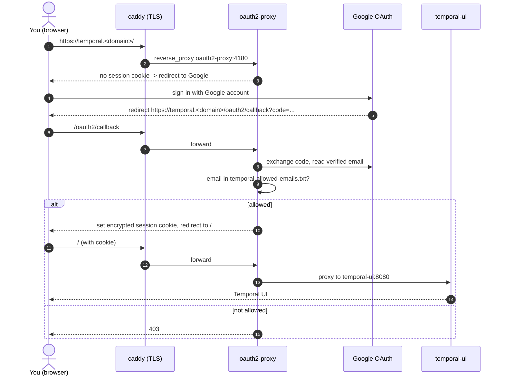

**Google setup (Google Cloud Console, browser):**
1. Create a project (or reuse one) → Google Auth Platform / OAuth consent screen: app name "dba Temporal", user type External (or Internal if you use Google Workspace), add your email as a test user while the app is in Testing.
2. Credentials → Create OAuth client ID → type **Web application**.
3. Authorized redirect URI: `https://temporal.<domain>/oauth2/callback` (add `http://localhost:8234/oauth2/callback` for laptop testing).
4. Copy client ID and secret into `.env` (`OAUTH2_PROXY_CLIENT_ID`, `OAUTH2_PROXY_CLIENT_SECRET`).

**oauth2-proxy configuration** (environment variables in `compose.server.yml`; each maps to the matching command-line flag):

| Setting | Value | Why |
|---|---|---|
| `OAUTH2_PROXY_PROVIDER` | `google` | Google sign-in |
| `OAUTH2_PROXY_CLIENT_ID` / `_CLIENT_SECRET` | from `.env` | OAuth client |
| `OAUTH2_PROXY_COOKIE_SECRET` | 32 random bytes, base64 | Encrypts the session cookie |
| `OAUTH2_PROXY_REDIRECT_URL` | `https://temporal.<domain>/oauth2/callback` | Must match the Google client |
| `OAUTH2_PROXY_AUTHENTICATED_EMAILS_FILE` | `/etc/oauth2-proxy/emails.txt` (mounted from `secrets/temporal-allowed-emails.txt`) | Only listed accounts get in |
| `OAUTH2_PROXY_EMAIL_DOMAINS` | not set (allowlist file decides) — or your Workspace domain instead of the file | Avoid allowing any Gmail account |
| `OAUTH2_PROXY_UPSTREAMS` | `http://temporal-ui:8080` | Temporal UI on the internal network |
| `OAUTH2_PROXY_HTTP_ADDRESS` | `0.0.0.0:4180` | Listened to by Caddy only |
| `OAUTH2_PROXY_REVERSE_PROXY` | `true` | Trust `X-Forwarded-*` from Caddy |
| `OAUTH2_PROXY_COOKIE_SECURE` | `true` | HTTPS-only cookie |
| `OAUTH2_PROXY_COOKIE_SAMESITE` | `lax` | Callback works, CSRF protection |
| `OAUTH2_PROXY_COOKIE_EXPIRE` | `12h` | Short sessions |
| `OAUTH2_PROXY_COOKIE_NAME` | `_dba_temporal` | Does not collide with the dba app session |
| `OAUTH2_PROXY_SKIP_PROVIDER_BUTTON` | `true` | Straight to Google (fewer clicks) |

**Caddy (`Caddyfile.server`):**
```caddyfile
temporal.{$DOMAIN} {
    reverse_proxy oauth2-proxy:4180
}
```

**Rules:**
- `temporal-ui` has no published port on servers and is attached only to the internal `app` network; the only path to it is Caddy → oauth2-proxy.
- Temporal's frontend gRPC port `7233` is never published (workers reach it on the internal network).
- Temporal UI's own write actions stay enabled for admins; oauth2-proxy is the access boundary. For a read-only demo link, set the UI's read-only mode **[VERIFY env var name for the pinned Temporal UI version]**.
- Sign out: `https://temporal.<domain>/oauth2/sign_out`.
- The Ops page links to `temporal.<domain>`; the link opens Google sign-in if needed.
- Laptop: Temporal UI stays on `127.0.0.1:8233` without sign-in (loopback only). To test the proxy locally, `docker compose --profile auth up oauth2-proxy` serves it on `http://localhost:8234` with `OAUTH2_PROXY_COOKIE_SECURE=false` and the localhost redirect URI.

**Alternative considered:** Temporal UI has built-in OIDC sign-in. oauth2-proxy is used instead because it keeps authentication outside the Temporal containers, uses a simple email allowlist, and can protect other internal tools later (e.g. `dev.<domain>`) without changes to them.

### 3.8 Isolation note
On a single host, untrusted repository code runs in sandboxes next to the devbox. Mitigations: sandboxes have no Docker socket, no GitHub credentials, no Bedrock credentials (gateway tokens only) and no route to the devbox; the devbox is on the `app` network only. For production use beyond the hackathon, run the devbox on a different machine (same compose file, `--profile devbox` only there).

---

## 4. Why Temporal (and the fallback)

| Need | Temporal feature |
|---|---|
| Survive crashes, redeploys, resume runs | Durable workflow history and replay |
| Retries with backoff | Activity retry policies |
| Long test runs and OpenCode sessions | Heartbeats + timeouts |
| Parallel PRs with limits | Child workflows + per-queue worker concurrency |
| Bedrock and GitHub rate limits | Task-queue `max_activities_per_second` |
| Pause / resume / cancel | Signals + cancellation |
| Approvals | Validated Updates + `wait_condition` with timeout |
| Waiting for CI | Durable timers |

**Fallback:** activities are plain `async def` functions with typed I/O. If Temporal blocks progress by **Saturday 16:00 IST**, replace the orchestration layer with DBOS or an asyncio + SQLite job table; activity code is unchanged.

---

## 5. Workflow design

### 5.1 Hierarchy

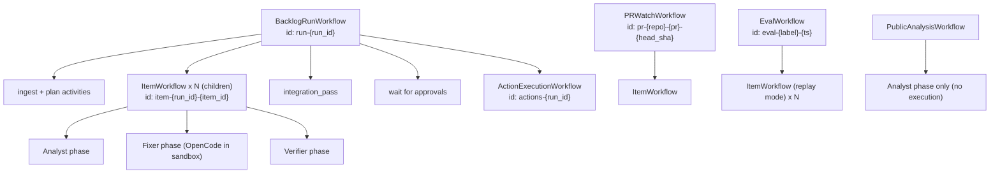

### 5.2 Workflows
| Workflow | Started by | Output |
|---|---|---|
| `BacklogRunWorkflow` | `POST /api/runs` | `RunSummary` |
| `ItemWorkflow` | Parent | `Verdict` + evidence refs |
| `ActionExecutionWorkflow` | Parent after approvals | Action results |
| `PRWatchWorkflow` | GitHub webhook (Dependabot PR opened/synchronized) | `Verdict` + proposed actions |
| `EvalWorkflow` | Admin UI | `EvalResult` |
| `PublicAnalysisWorkflow` | Public form | Read-only report |
| `EconomicsSyncWorkflow` | End of `EvalWorkflow`, or Admin button | cfo.ai Scenario updated |
| `EntireLoginWorkflow` | Ops → Integrations → "Connect Entire" | Token stored on `entire-auth` volume; status shown in UI |

### 5.3 Signals, queries, updates
| Name | Type | Target | Purpose |
|---|---|---|---|
| `pause`, `resume` | signal | run | Stop/restart dispatching new items |
| `cancel` | cancellation | any | Cancel children; cleanup runs in `finally` |
| `approve_actions`, `reject_actions` | update (validated) | run | Approve/reject proposed actions |
| `override_verdict` | signal | item | Human verdict; becomes an eval label |
| `get_status` | query | run, item | Header state on page load |

### 5.4 Determinism and history rules
- Workflow code: no I/O, no clock (use `workflow.now()`), no randomness, no model calls.
- Workflow code is not instrumented with neatlogs (replays would duplicate spans); activities are.
- Large payloads go to the evidence store; workflows carry references (`sha256`).
- No secrets in workflow inputs or history. Activities mint GitHub tokens and gateway tokens themselves.
- Deterministic workflow IDs deduplicate repeated starts (e.g. duplicate webhooks).

---

## 6. End-to-end run

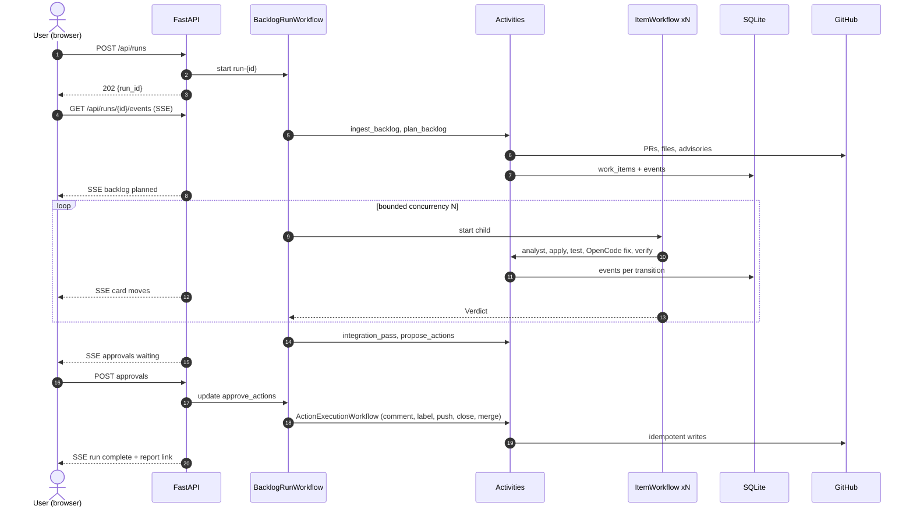

---

## 7. Agent orchestration

### 7.1 Principle
**Code chooses the next step; an agent decides what to do inside a step.** The workflow state machine controls phase order, budgets, retries and handoffs. LLM agents act only inside a phase and must end by producing a typed output.

### 7.2 Agent roster

| Agent | Runs as | Model access | Decides | Input contract | Output contract |
|---|---|---|---|---|---|
| **Coordinator** | `BacklogRunWorkflow` (mostly deterministic) | `orchestrator` model only for grouping fallback + report text | Order, groups, concurrency, integration pass, action proposals | Backlog, repo settings | `RunSummary`, `Action[]` |
| **Analyst** | In-house tool-use loop (section 8) inside `ItemWorkflow` | `orchestrator` model via `AsyncOpenAI` | Which usages/paths matter, risk, expected breakage | `WorkItem` + deterministic analysis (changed symbols, call sites, impact) | `AnalysisReport` |
| **Fixer** | **OpenCode** headless in the sandbox, captured by **Entire** | `coder` model via `llm-gateway` | How to change repo code so tests pass | `FixBrief` (markdown file written by harness) | Working-tree diff → harness validates → `FixAttempt` |
| **Fixer (fallback)** | In-house tool-use loop | `coder` model | Same | Same | Unified diff |
| **Verifier** | Deterministic checks + in-house LLM check | `orchestrator` model | Confirm / reject / downgrade | `DraftVerdict` + evidence refs (no reasoning) | `VerifierDecision` |
| **Reviewers + judge** | `entire review` in the review container | `coder` model through `llm-gateway` (two reviewers can use different models) | Second opinion on patched branches | Patched branch + prompt | Review verdict |

### 7.3 Handoffs

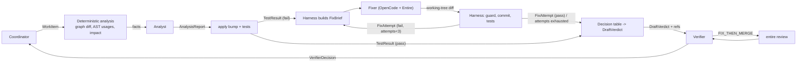

Rules:
- Agents never share a conversation. They exchange typed objects plus evidence references.
- The verifier never sees the analyst's or fixer's reasoning, only artifacts.
- The deterministic decision table (section 10.2) produces the draft verdict from facts; the analyst's opinion is one input and the stricter outcome wins on disagreement.
- The fixer never runs tests or commits itself in a way the harness trusts; the harness re-runs tests and owns the commit.

### 7.4 Data contracts
```text
WorkItem        { item_id, run_id, repo, base_sha, prs[], packages[{name,from,to,manifest,dev_only}],
                  advisories[], bump_type, priority }
AnalysisReport  { reachability: REACHABLE|UNREACHABLE|UNCERTAIN, paths[], risk: LOW|MED|HIGH,
                  expected_breakage[], notes, evidence_refs[] }
FixBrief        { failing_tests[], failure_tail_ref, changed_symbols[], call_sites[], impact[],
                  previous_attempts[{diff_ref, result}], constraints[] }
FixAttempt      { attempt, diff_ref, files[], guard: allow|deny, guard_reasons[], test_result_ref,
                  commit_sha?, entire_checkpoint_id?, tokens?, usd? }
DraftVerdict    { verdict, reason_code?, reachability, confidence, summary,
                  claims[{claim, evidence_ref}] }
VerifierDecision{ decision: CONFIRM|REJECT|DOWNGRADE, checks{}, review?{verdict, ref} }
```

---

## 8. Agent harness

The harness is everything around an agent that makes its behaviour bounded, observable and checkable. dba has two harness modes: **in-house** (Analyst, Verifier check, fallback Fixer) and **external-agent** (OpenCode Fixer).

### 8.1 Components

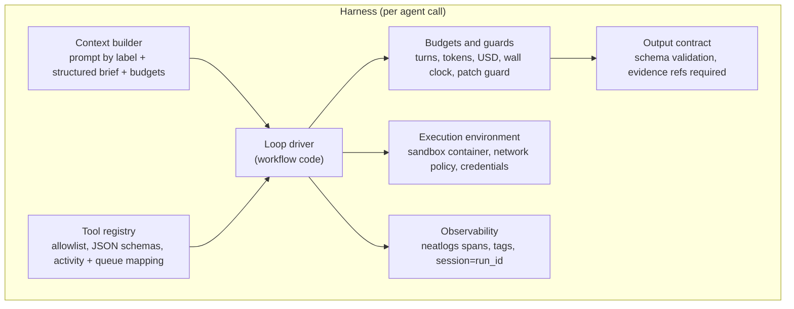

| Component | In-house agents | OpenCode fixer |
|---|---|---|
| Context builder | System prompt from neatlogs (`fetch_prompt(name, label)`) + structured brief, each section size-budgeted; untrusted text fenced as data | `FixBrief` rendered to `/work/.dba/brief.md`; instructions from `dba-fixer` agent file (prompt text from neatlogs at build of the brief) |
| Tool registry | Per-agent allowlist; each tool → activity on a queue; args validated with pydantic | OpenCode's own tools, restricted by the `dba-fixer` agent permissions |
| Loop driver | Workflow loop: `llm_call` activity → tool activities → append results | One `opencode_fix` activity; OpenCode runs its own loop |
| Budgets | 25 turns, 200k input tokens, USD cap, 15 min per item | Wall-clock timeout per attempt (8 min), max 3 attempts, token/cost read after run |
| Guards | Patch guard on fallback fixer diffs | Patch guard on the working-tree diff before commit; `git reset --hard` on deny |
| Output contract | `submit_verdict` / `submit_analysis` tool schemas | Harness-produced `FixAttempt`; OpenCode's text answer is stored, not trusted |
| Execution environment | Worker process; tools execute in the sandbox | Inside the sandbox container; model access only through `llm-gateway` with a per-attempt token |
| Observability | Auto-instrumented Bedrock calls + tool spans | One `TOOL` span per attempt (brief, diff, tokens, transcript ref) + Entire checkpoint id |

### 8.2 In-house loop (Analyst, fallback Fixer)

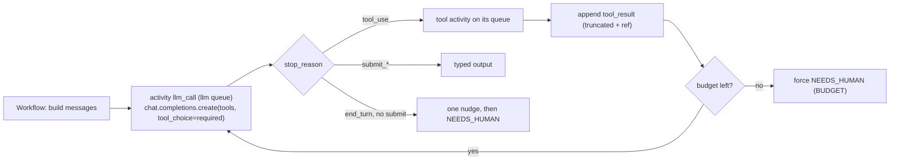

Each model call and tool call is its own Temporal activity, so a crash resumes mid-loop without repeating completed calls.

### 8.3 External-agent loop (OpenCode Fixer)

```mermaid
sequenceDiagram
    autonumber
    participant IW as ItemWorkflow
    participant OR as worker-orch
    participant SB as worker-sandbox
    participant C as Sandbox container
    participant OC as OpenCode
    participant EN as Entire (plugin + git hooks)

    IW->>OR: issue_gateway_token(item, attempt)
    OR-->>IW: token (15 min, fixer model, token budget)
    IW->>SB: opencode_fix(item, attempt, brief_ref, token)
    SB->>C: write /work/.dba/brief.md
    SB->>C: connect container to sandbox-llm network (gateway only)
    SB->>C: exec: opencode run --agent dba-fixer "<brief pointer>" (env: DBA_GATEWAY_TOKEN)
    C->>OC: OpenCode loop via llm-gateway -> Bedrock, edits files
    OC->>EN: turn-end -> opencode export -> session captured
    SB->>C: disconnect from sandbox-llm
    IW->>OR: revoke_gateway_token
    SB->>C: git diff -> diff_ref
    SB->>SB: patch_guard(diff)
    alt guard allows
        SB->>C: git commit -m "dba fix attempt n"
        C->>EN: post-commit hook -> checkpoint linked to session
        SB->>C: run_tests (network none)
    else guard denies
        SB->>C: git reset --hard; git clean -fd
    end
    SB-->>IW: FixAttempt {diff_ref, guard, test_result_ref, commit_sha, checkpoint_id}
```

The activity heartbeats every 30 s while OpenCode runs, so a hung session is detected by Temporal and retried or failed.

### 8.4 Patch guard (deterministic)
Rejects a diff that touches `tests/`, `test_*.py`, `*_test.py`, `conftest.py`; adds skip/xfail markers or coverage pragmas; edits CI, `pyproject.toml` test settings or `pytest.ini`; pins the package back; touches `.dba/`, `.opencode/`, `.entire/`; or exceeds 200 changed lines.

---

## 9. Item lifecycle

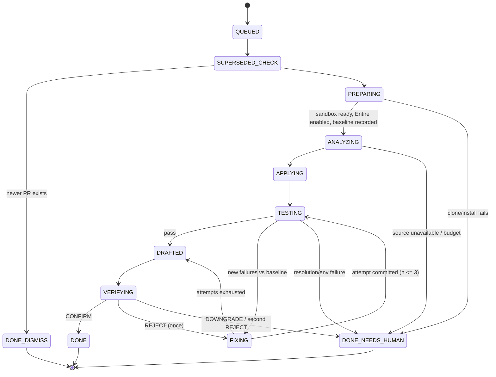

Each transition calls the local activity `record_event` (SQLite), which feeds the UI. `destroy_sandbox` and `export_checkpoints` run in `finally`.

---

## 10. Analysis pipeline

### 10.1 Flow

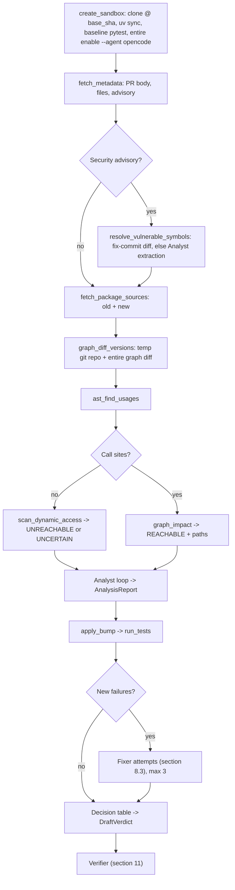

### 10.2 Decision table (`core/decision.py`)

| Changed/vulnerable symbols called? | Dynamic access? | Tests after bump | Draft verdict |
|---|---|---|---|
| no | no | pass | `MERGE` |
| no | no | fail → fixed ≤3 | `FIX_THEN_MERGE` |
| no | no | fail, not fixed, non-security | `DISMISS / UNREACHABLE_AND_BREAKING` |
| no | no | fail, not fixed, security | `NEEDS_HUMAN` |
| no | yes | pass | `MERGE` (confidence ≤ 0.7) |
| no | yes | fail, not fixed | `NEEDS_HUMAN` |
| yes | any | pass | `MERGE` |
| yes | any | fail → fixed ≤3 | `FIX_THEN_MERGE` |
| yes | any | fail, not fixed | `NEEDS_HUMAN` |
| dev-only, unused | no | n/a | `DISMISS / DEV_ONLY_NO_IMPACT` |

### 10.3 Why AST + entire-graph
`entire graph diff` gives a deterministic changed-symbol list between package versions. The AST scan finds edges from repo code into the dependency (graph edges into third-party code may not resolve **[VERIFY]**). `entire graph impact` expands inside the repo to routes and entrypoints.

---

## 11. Verification

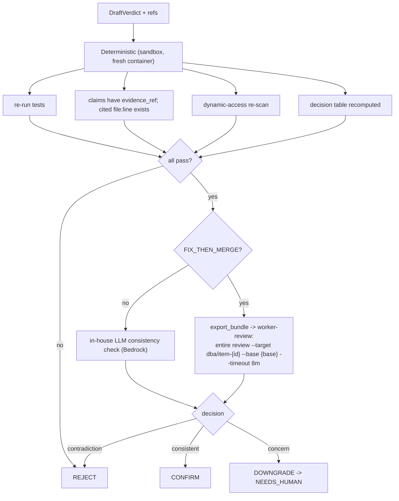

- Review profile reviewers: two OpenCode reviewers through `llm-gateway`, optionally on different open models for diversity; judge on `orchestrator` or `coder` **[VERIFY `entire review` supports OpenCode]**. If not supported: in-house consistency check.
- On review timeout or failure: fall back to the in-house check and record it.
- `REJECT` returns the item to FIXING once; a second reject becomes `NEEDS_HUMAN`.

---

## 12. Backlog orchestration

- **Supersession:** same package in two PRs → keep the higher target; the other is `DISMISS/SUPERSEDED`.
- **Grouping:** seed list (`boto3`+`botocore`, `pytest`+`pytest-*`, `django`+`djangorestframework`, `sqlalchemy`+`alembic`); Bedrock fallback for unknown pairs on the same lockfile lines.
- **Priority:** CVSS ≥ 7 +100; any advisory +50; patch +20; minor +10; major 0; runtime dep +10; age/30 capped +10.
- **Concurrency:** parent runs at most N children (default 3). Queue limits: `sandbox` `max_concurrent_activities=3`; `llm` and OpenCode calls rate-limited to your Bedrock quota; `github` rate-limited.
- **Integration pass:** apply all `MERGE`/`FIX_THEN_MERGE` items on `dba/integration`, run tests once, bisect failures → `NEEDS_HUMAN / INTERACTION_FAILURE`.
- **Merge sequencing:** one at a time; rebase, wait for checks with durable timers (max 20 min), merge if green, else `NEEDS_HUMAN / CI_FAILED`.

---

## 13. PR actions and approvals

| Level | Actions | Default approval |
|---|---|---|
| 0 | Web report only | — |
| 1 | Comment verdict + evidence; labels `dba:merge`, `dba:fix`, `dba:dismiss`, `dba:needs-human` | Auto |
| 2 | Push fix commit (Dependabot branch or `dba/fix-*`) | Auto |
| 3 | Combined PR for a group; close originals with link | Manual |
| 4 | Close `DISMISS` PRs via `@dependabot close` / `@dependabot ignore this major version` | Manual |
| 5 | Merge `MERGE` / `FIX_THEN_MERGE` | Manual |

Hard rules (activity layer): writes only to installed repos; merge only with verifier `CONFIRM` + sandbox green + integration clean + PR checks green; close only `DISMISS` with reason; `NEEDS_HUMAN` gets label + comment only; hidden marker `<!-- dba:{item_id} -->` makes comments idempotent; unique action key `(repo, pr, type, item_id)`; action cancelled if PR head SHA changed since analysis.

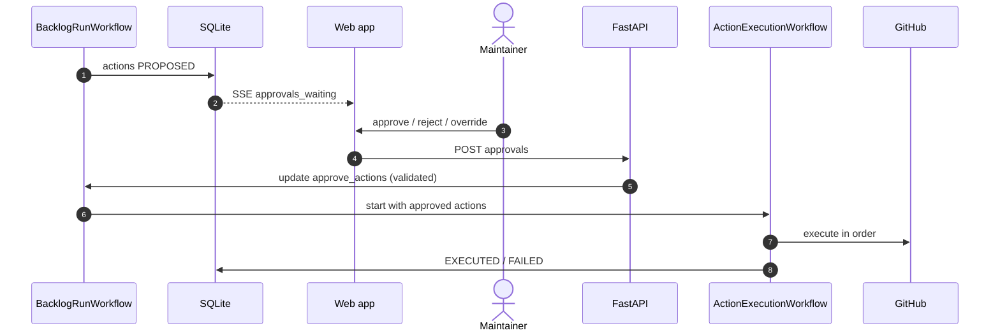

Approval wait times out after 24 h; remaining actions stay `PROPOSED` and can be approved later.

---

## 14. Activity catalog

Queues: `orch`, `llm`, `sandbox`, `github`, `review`, `economics`.

| Activity | Queue | Timeout | Heartbeat | Retries | Notes |
|---|---|---|---|---|---|
| `record_event` | orch (local) | 5s | — | 3 | |
| `fetch_prompt` | orch | 10s | — | 3 | neatlogs `get_prompt` |
| `issue_gateway_token` / `revoke_gateway_token` | orch | 10s | — | 3 | section 19.5 |
| `ingest_backlog` | github | 60s | — | 5 | |
| `fetch_advisory` | github | 30s | — | 5 | GHSA → OSV fallback |
| `plan_backlog` | orch | 60s | — | 2 | |
| `create_sandbox` | sandbox | 10m | 30s | 2 | clone, `uv sync`, baseline, `entire enable --agent opencode` |
| `fetch_package_sources` | sandbox | 3m | 30s | 3 | |
| `graph_diff_versions` | sandbox | 3m | 30s | 2 | |
| `ast_find_usages`, `scan_dynamic_access` | sandbox | 2m | — | 2 | |
| `graph_impact`, `graph_neighbors` | sandbox | 2m | — | 2 | LLM-callable |
| `read_file_range` | sandbox | 15s | — | 2 | LLM-callable |
| `read_changelog` | github | 30s | — | 3 | LLM-callable |
| `llm_call` | llm | 3m | — | 4 | `AsyncOpenAI` → Bedrock; schema-repair turns handled in the loop; non-retryable on 4xx |
| `apply_bump` | sandbox | 5m | 30s | 2 | |
| `run_tests` | sandbox | 10m | 30s | 1 | network none; flaky rerun once |
| `opencode_fix` | sandbox | 10m | 30s | 1 | section 8.3 |
| `fallback_fix_apply` | sandbox | 1m | — | 1 | for in-house fixer diffs |
| `patch_guard` | orch | 10s | — | 0 | |
| `verify_deterministic` | sandbox | 12m | 30s | 1 | |
| `export_bundle` | sandbox | 2m | — | 2 | `git bundle` incl. `refs/entire/checkpoints/*` |
| `entire_review` | review | 10m | 60s | 1 | reviewers use `llm-gateway` |
| `export_checkpoints` | github | 2m | — | 3 | push `refs/entire/checkpoints/*` to checkpoint repo |
| `entire_device_login` | review | 15m | 15s | 0 | runs `entire login`, emits URL + code as events, waits for approval |
| `entire_auth_status` | review | 30s | — | 2 | `entire auth status` for the Ops page |
| `destroy_sandbox` | sandbox | 1m | — | 5 | `finally` |
| `integration_pass` | sandbox | 20m | 30s | 1 | |
| `propose_actions` | orch | 30s | — | 3 | |
| `gh_comment`, `gh_label`, `gh_close`, `gh_open_combined_pr` | github | 30s | — | 5 | idempotent |
| `gh_push_branch` | github | 2m | — | 3 | |
| `get_check_status` | github | 30s | — | 5 | with durable timer |
| `gh_merge` | github | 60s | — | 2 | |
| `write_report` | orch | 60s | — | 3 | |
| `build_economics_snapshot` | orch | 60s | — | 3 | JSON to `data/blobs` |
| `cfo_sync` | economics | 10m | 30s | 1 | OpenCode + cfo.ai MCP |

---

## 15. Data model (SQLite)

**Engine:** SQLite file `data/dba.sqlite3`, accessed through SQLAlchemy 2 async with `aiosqlite` (`DATABASE_URL=sqlite+aiosqlite:////data/dba.sqlite3`). Migrations with Alembic (`render_as_batch=True` for SQLite ALTERs).

**Connection settings (on every connection):** `PRAGMA journal_mode=WAL; PRAGMA busy_timeout=5000; PRAGMA foreign_keys=ON; PRAGMA synchronous=NORMAL;`

**Concurrency model:** all services share one file on the same host's disk (bind-mounted `./data`; never on a network filesystem). WAL allows concurrent readers and one writer at a time. Writes are small (events, items, actions, costs) and go through short transactions; `record_event` and other writers retry on `database is locked` with jittered backoff (Temporal retry policy as a second layer). Expected write rate is tens per second at most, well within SQLite's limits.

**Portability:** JSON stored in `JSON` columns (TEXT in SQLite), lists stored as JSON, no SQLite-only SQL in queries. Switching to Postgres later means changing `DATABASE_URL` and running migrations.

```sql
installations(installation_id INTEGER PK, account_login TEXT, created_at TEXT)
repos(repo_id INTEGER PK, installation_id INTEGER, full_name TEXT, default_branch TEXT,
      action_level INTEGER, auto_approve JSON)
runs(run_id TEXT PK, repo_id INTEGER, mode TEXT, prompt_label TEXT, status TEXT, config JSON,
     started_at TEXT, finished_at TEXT, workflow_id TEXT, share_id TEXT UNIQUE)
work_items(item_id TEXT PK, run_id TEXT, prs JSON, packages JSON, advisories JSON, bump_type TEXT,
           priority INTEGER, state TEXT, attempts INTEGER, verdict TEXT, reason_code TEXT,
           confidence REAL, updated_at TEXT)
events(id INTEGER PRIMARY KEY AUTOINCREMENT, run_id TEXT, item_id TEXT, type TEXT,
       from_state TEXT, to_state TEXT, detail JSON, at TEXT)          -- INDEX (run_id, id)
evidence(item_id TEXT PK, payload JSON)
blobs(sha256 TEXT PK, kind TEXT, path TEXT, size INTEGER)
fix_attempts(item_id TEXT, attempt INTEGER, diff_sha TEXT, guard TEXT, test_sha TEXT,
             commit_sha TEXT, entire_checkpoint_id TEXT, tokens_in INTEGER, tokens_out INTEGER,
             usd REAL, PRIMARY KEY (item_id, attempt))
verdicts(item_id TEXT PK, draft JSON, final JSON, verifier JSON)
actions(action_id TEXT PK, run_id TEXT, item_id TEXT, repo TEXT, pr INTEGER, type TEXT,
        payload JSON, status TEXT, approved_by TEXT, executed_at TEXT, result JSON,
        UNIQUE (repo, pr, type, item_id))
overrides(item_id TEXT PK, user_login TEXT, verdict TEXT, reason TEXT, at TEXT)
gateway_tokens(jti TEXT PK, item_id TEXT, attempt INTEGER, model TEXT, max_tokens INTEGER,
               expires_at TEXT, used_in INTEGER, used_out INTEGER, revoked INTEGER)
costs(item_id TEXT, run_id TEXT, activity TEXT, model TEXT, in_tok INTEGER, out_tok INTEGER,
      usd REAL, ms INTEGER)                                          -- INDEX (run_id)
eval_cases(case_id TEXT PK, dataset TEXT, payload JSON, label TEXT)
eval_results(eval_id TEXT, case_id TEXT, prompt_label TEXT, predicted TEXT, correct INTEGER,
             usd REAL, ms INTEGER)
```

Blobs: files under `data/blobs/{sha256[0:2]}/{sha256}`; metadata in `blobs`.

---

## 16. Web application

### 16.1 Architecture

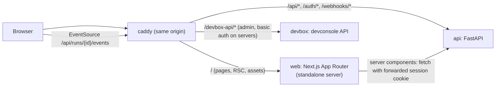

| Layer | Choice |
|---|---|
| Framework | **Next.js** (current stable, App Router, TypeScript strict, `output: "standalone"`), pinned at kickoff |
| Components | **shadcn/ui** (CLI `npx shadcn@latest add …`), components copied into `web/components/ui` |
| Styling | **Tailwind CSS** (v4) with shadcn CSS-variable theme tokens; `tw-animate-css` for enter/exit animations |
| Icons | **lucide-react** only |
| Motion | Tailwind transitions + shadcn `data-[state]` animations by default; `motion` (Motion for React) only for layout and presence animations that CSS cannot express (section 16.6) |
| Server state | TanStack Query (fetch, cache, optimistic mutations); live SSE events patch the query cache |
| Forms | shadcn Field + react-hook-form + zod |
| Theme | `next-themes` (light/dark/system), shadcn theming |
| Fonts | Geist Sans / Geist Mono via `next/font` |
| Charts | shadcn Chart |
| Auth | Session cookie issued by FastAPI after GitHub sign-in; Next.js middleware redirects unauthenticated users to `/connect` |
| Same origin | Caddy routes pages to `web` and `/api` to `api` on laptops (HTTP, `localhost:8080`) and servers (HTTPS). No CORS, cookies shared, SSE goes straight to FastAPI without passing through Next.js |

### 16.2 API (FastAPI, unchanged contract)

| Method | Path | Purpose |
|---|---|---|
| GET | `/auth/login`, `/auth/callback`, `/auth/me`, POST `/auth/logout` | GitHub OAuth, session |
| GET / PATCH | `/api/repos`, `/api/repos/{id}` | Repos; action level, auto-approve |
| GET | `/api/repos/{id}/backlog` | Open Dependabot PRs |
| POST | `/api/repos/{id}/plan` | Plan preview + cost estimate |
| POST | `/api/runs` | Start run |
| GET | `/api/runs/{id}`, `/api/runs/{id}/events` | Summary; SSE (with `Last-Event-ID`) |
| POST | `/api/runs/{id}/pause`, `/resume`, `/cancel` | Control |
| GET | `/api/items/{id}`, `/api/blobs/{sha}` | Item detail; logs/diffs |
| GET / POST | `/api/runs/{id}/actions`, `/api/runs/{id}/approvals` | Actions; approve/reject |
| POST | `/api/items/{id}/override` | Override verdict |
| POST / GET | `/api/runs/{id}/share`, `/api/public/reports/{share_id}` | Public report data |
| POST | `/api/public/analyze` | Read-only analysis (rate-limited, cost-capped) |
| POST | `/webhooks/github` | Signed webhooks → `PRWatchWorkflow` |
| GET / POST | `/api/admin/evals` | Evals |
| GET | `/api/admin/economics.json`, `.csv` | cfo.ai export |
| GET | `/api/admin/ops` | Deployed version, queue/worker health, integration status |
| POST / GET / POST | `/api/admin/integrations/entire/login`, `/status`, `/logout` | Entire device login (code arrives over SSE) |
| POST | `/api/admin/integrations/bedrock/test` | One traced Bedrock call |
| POST | `/api/admin/economics/sync` | Start `EconomicsSyncWorkflow` |
| GET | `/api/admin/events` | SSE for admin jobs (login codes, sync progress) |

### 16.3 Live updates
`record_event` → `events` table (SQLite) → SSE endpoint polls `SELECT … WHERE run_id=? AND id>? ORDER BY id` every 500 ms (indexed) → browser `EventSource` (hook `useRunEvents`) → events applied to the TanStack Query cache → components re-render with transitions (section 16.6). Reconnect resumes from `Last-Event-ID`; a connection indicator (Badge + pulsing dot) shows live / reconnecting.

### 16.4 Routes (App Router)

| Route | Screen | Rendering |
|---|---|---|
| `/` | Redirect to `/repos` or `/connect` | Middleware |
| `/connect` | Sign in, install GitHub App, or analyze a public repo | Server |
| `/repos` | Connected repositories | Server + client table |
| `/repos/[repoId]` | Backlog (planned order, cost estimate) | Server initial data + client |
| `/repos/[repoId]/settings` | Repo settings | Client form |
| `/runs/[runId]` | Run board | Client (live) |
| `/runs/[runId]/@sheet/(.)items/[itemId]` | Item detail as a Sheet over the board (intercepting route; URL shareable, Back closes it) | Client |
| `/items/[itemId]` | Item detail full page (direct link) | Server + client |
| `/runs/[runId]/approvals` | Approvals | Client |
| `/runs/[runId]/report` | Report | Server |
| `/r/[shareId]` | Public read-only report | Server (no auth) |
| `/analyze` | Public analysis form + result | Client |
| `/admin/ops` · `/admin/integrations` · `/admin/evals` · `/admin/economics` · `/admin/devconsole` | Admin pages | Client |

Each route segment has `loading.tsx` (Skeletons matching the final layout) and `error.tsx` (Alert + retry Button).

### 16.5 Component policy (mandatory)

Order of preference for every UI element:

1. **shadcn component as-is.** Added with the shadcn CLI. Adapted only through props, variants (`cva`) and `className` with theme tokens. Generated files in `components/ui/` are edited only to add variants, and each edit is noted at the top of the file.
2. **Composition of shadcn components.** When shadcn has no single component for the need, build it in `components/composed/` using only shadcn components, Tailwind classes, theme tokens and lucide icons.
3. **Custom component.** Only when steps 1–2 cannot produce it. Lives in `components/custom/`, starts with a comment stating which shadcn components were considered and why they are insufficient, and must be added to the table in 16.5.3. Target: zero custom components.

Hard rules:
- Icons: `lucide-react` only, sized via Tailwind (`size-4` default, `size-5` in headers).
- Colors, radii, shadows, spacing: theme tokens and Tailwind scale only. No hex values, no inline styles (except values a shadcn component already takes, e.g. Progress `value`).
- No other component libraries.
- Accessibility comes from the shadcn primitives; composed components keep keyboard navigation, focus-visible rings and ARIA labels on icon-only buttons.

#### 16.5.1 shadcn components used

| Component | Where |
|---|---|
| Sidebar, Breadcrumb, Separator, Avatar, Dropdown Menu | App shell |
| Command (+ Dialog), Kbd | ⌘K command palette, shortcut hints |
| Card, Item, Typography | Panels, list rows, text styles |
| Button, Button Group, Toggle, Toggle Group | Actions, filters, view switches |
| Badge, Tooltip, Hover Card | Verdicts, states, PR previews |
| Data Table, Table, Checkbox, Pagination | Repos, backlog, approvals, evals |
| Tabs, Accordion, Collapsible | Item detail sections, evidence groups |
| Sheet, Dialog, Alert Dialog, Drawer | Item quick view, forms, destructive confirms, mobile panels |
| Progress, Spinner, Skeleton | Goal progress, pending states, loading |
| Toast | Results of actions, background events |
| Empty | Empty states |
| Alert | Errors, warnings, info banners |
| Field, Input, Input Group, Textarea, Label, Select, Native Select, Radio Group, Switch, Slider, Combobox | Forms and settings |
| Input OTP (read-only) | Entire device code display |
| Scroll Area, Resizable | Logs, diffs, board columns; item detail split view |
| Chart | Evals and economics |
| Calendar, Date Picker | Eval and report date filters |

#### 16.5.2 Composed components (`components/composed/`)

| Component | Built from | Purpose |
|---|---|---|
| `AppShell` | Sidebar, Breadcrumb, Separator, Avatar, Dropdown Menu, Toggle (theme), Command | Layout, navigation, ⌘K |
| `PageHeader` | Typography, Breadcrumb, Button Group | Title, context, one primary action |
| `StatCard` | Card, Typography, Badge, Tooltip | KPI with delta |
| `VerdictBadge` | Badge + lucide icon + Tooltip | `MERGE` (GitMerge), `FIX_THEN_MERGE` (Wrench), `DISMISS` (CircleSlash), `NEEDS_HUMAN` (UserRound); icon + text, never color alone |
| `StateBadge` | Badge + Spinner | Item state with activity indicator |
| `RunProgress` | Progress, Typography, Tooltip | "18 of 30 resolved", goal gradient |
| `ConnectionIndicator` | Badge, Tooltip | Live / reconnecting SSE status |
| `KanbanBoard`, `KanbanColumn`, `KanbanCard` | Card, Badge, Item, Scroll Area, Hover Card, Skeleton, Empty | Run board (read-only; cards move by system events) |
| `ItemSheet` | Sheet, Tabs, Accordion, Table, Badge, Scroll Area, Button Group | Item detail quick view |
| `EvidenceList` | Item, Badge, Button (link variant), Tooltip | Call sites with GitHub links |
| `ReachabilityPath` | Breadcrumb (ChevronRight separators), Badge | Entrypoint → call site path |
| `CodeBlock` | Scroll Area, Typography (code), Button (copy), Tooltip | Logs, transcripts |
| `DiffView` | Table, Scroll Area, Badge, Toggle Group (unified/split) | Patch diffs with token-based add/remove row colors |
| `TestResultPanel` | Collapsible, Table, Badge, CodeBlock | Baseline vs after, failing tests |
| `AttemptTimeline` | Item, Separator, Badge, Collapsible, Button | Fix attempts as a vertical timeline (stepper) |
| `ActionLevelPicker` | Radio Group + Card + Field | Level 0–5 with descriptions and examples |
| `ApprovalsTable` | Data Table, Checkbox, Badge, Dropdown Menu, Alert Dialog, Toast | Batch approve/reject |
| `CostMeter` | Progress, Tooltip, Typography | Cost vs cap |
| `DeviceCodeCard` | Card, Input OTP (read-only), Button (copy, open link), Spinner, Alert | Entire login |
| `LiveLog` | Scroll Area, CodeBlock, Toggle (auto-scroll), Badge | Admin job output |
| `OnboardingChecklist` | Card, Checkbox (read-only), Progress, Item, Button | First-run setup steps |
| `ConfirmAction` | Alert Dialog, Button | Merge/close/cancel confirmation |
| `EmptyState` | Empty, Button | Every empty list |
| `ShortcutHint` | Kbd, Tooltip | Keyboard shortcuts next to actions |

#### 16.5.3 Custom components
None planned. Any addition must be justified here before it is written.

### 16.6 Motion and transitions

Every interaction gives visible feedback through a transition. Motion explains change (where something came from or went); it never delays the user.

| Token | Duration | Easing | Used for |
|---|---|---|---|
| `fast` | 150 ms | `ease-out` | Hover, press, focus, color changes, toggles, tooltips |
| `base` | 200 ms | `ease-out` (enter) / `ease-in` (exit) | Dropdowns, popovers, dialogs, tabs, toasts, route content fade |
| `slow` | 300 ms | `ease-in-out` or spring (stiffness 400, damping 35) | Sheets, drawers, card moves between columns, list insert/remove |

Rules:
1. **All interactive elements:** `transition-colors` (or `transition-[color,background-color,box-shadow,transform]`) with `fast`; buttons add `active:scale-[0.98]`; focus-visible ring animates in.
2. **Overlays** (Dialog, Alert Dialog, Sheet, Drawer, Popover, Dropdown, Tooltip, Hover Card, Command, Toast) use shadcn's built-in `data-[state=open|closed]` animations from `tw-animate-css` (fade + zoom/slide). Not reimplemented.
3. **Route changes:** `template.tsx` fades and lifts content (opacity 0→1, `translate-y-1`→0, `base`); layout (sidebar, header) stays still.
4. **Run board:** cards move between columns with `motion` layout animations (`layout`, `LayoutGroup`), `slow` spring; new cards enter with fade + scale 0.98→1; column counts animate.
5. **Lists and tables:** inserted/removed rows animate height and opacity (`AnimatePresence`, `base`); row hover uses `fast` background transition.
6. **Live highlight:** an item that changes state flashes a subtle token-colored background that fades out over 1 s (decorative, non-blocking).
7. **Numbers:** counters and costs tween over 300 ms when they change.
8. **Progress:** Progress bars transition width with `slow`.
9. **Loading:** Skeletons appear only if loading exceeds 150 ms (avoid flicker) and cross-fade to content; buttons show an inline Spinner and keep their width while pending.
10. **Optimistic updates** for approve/reject, pause/resume and overrides: UI changes immediately, reverts with a Toast on error.
11. **Reduced motion:** `motion-reduce:` variants and `useReducedMotion()` remove transforms and layout animations, keeping only opacity changes ≤150 ms.
12. **No layout shift:** reserve space for badges, counters and async content; animate `transform` and `opacity`, never width/height of large containers (except via `motion` layout).
13. **Never block input** with an animation; no animation exceeds 300 ms except the decorative live highlight.

### 16.7 Laws of UX (lawsofux.com) applied

| Law | Rule in this UI | Where |
|---|---|---|
| Aesthetic-Usability Effect | Consistent shadcn theme, spacing scale, typography; polished empty/loading/error states | Everywhere |
| Choice Overload | Max one primary and two secondary actions per view; advanced options in Collapsible/Accordion | Backlog, settings, item detail |
| Chunking | Item detail split into Tabs (Overview, Evidence, Tests, Fixes, Review, Trace); backlog grouped by package family | Item detail, backlog |
| Cognitive Bias | Show evidence before verdict actions; confirmation dialogs restate consequences neutrally; no pre-checked destructive options | Approvals, overrides |
| Cognitive Load | Progressive disclosure; plain-language labels ("Can reach vulnerable code" instead of "REACHABLE") with technical term in Tooltip | Badges, item detail |
| Doherty Threshold | Feedback < 100 ms (press states, optimistic updates); data views < 400 ms or Skeleton; SSE latency ≈ 500 ms shown as live | All interactions |
| Fitts's Law | Primary buttons ≥ 40 px tall, placed where the eye ends (top-right of PageHeader, bottom of Sheet/Dialog); whole cards and rows clickable; icon buttons ≥ 36 px | All screens |
| Flow | Item opens in a Sheet over the board (no context loss); keyboard navigation `j`/`k` between items, `Esc` closes; no modal interruptions for non-critical events (Toasts instead) | Run board, item sheet |
| Goal-Gradient Effect | `RunProgress` "N of M resolved" and PR count going to 0; onboarding checklist progress | Run board, connect |
| Hick's Law | Action level as 6 described radio cards with a recommended default; filters limited to the few most used, rest under "More" | Settings, backlog |
| Jakob's Law | Conventional patterns: left sidebar nav, ⌘K palette, GitHub-like diffs and PR links, standard table sorting, Back closes sheets | Everywhere |
| Law of Common Region | Cards/columns group related data; each Kanban column is a bounded region | Board, item detail |
| Law of Proximity | Labels next to values; actions next to the object they affect; consistent spacing tokens (`gap-2` inside, `gap-6` between groups) | Everywhere |
| Law of Prägnanz | Simple shapes, minimal borders, one accent color for primary actions | Theme |
| Law of Similarity | Same verdict = same badge color + icon everywhere; same action = same button variant | Badges, buttons |
| Law of Uniform Connectedness | `ReachabilityPath` connects entrypoint → call site visually; `AttemptTimeline` connects attempts with a line | Item detail |
| Mental Model | Vocabulary matches GitHub and Dependabot (PR, merge, close, bump); states mirror the lifecycle users expect | Copy, states |
| Miller's Law | ≤ 7 Kanban columns; ≤ 7 sidebar entries per group; long lists paginated or grouped | Board, nav |
| Occam's Razor | Each screen has one job; remove decorative elements that carry no information | All screens |
| Paradox of the Active User | No manual required: inline hints, sensible defaults (action level 1), empty states that explain the next step with one button | Connect, settings, empty states |
| Pareto Principle | Optimize the 20% of flows used most: start run, watch board, review item, approve | Navigation, shortcuts |
| Parkinson's Law | Show estimated run time and cost before start; budget caps visible during the run | Backlog, board |
| Peak-End Rule | Peak: a fixed PR flips to green with a highlight; End: report with "N updates cleared, X hours saved" and a share button | Board, report |
| Postel's Law | Accept repo input as URL, `owner/repo` or pasted PR link; tolerant search; strict, clear validation messages | Analyze, connect |
| Selective Attention | Attention-needing states (Needs human, approvals waiting) use the warning token and a sidebar count Badge; everything else stays neutral; no banner blindness (no permanent banners) | Board, sidebar |
| Serial Position Effect | Most important nav items first and last in the sidebar; primary actions at the start/end of groups | Sidebar, toolbars |
| Tesler's Law | System absorbs complexity: planning, grouping, reachability and retries are automatic; users only decide approvals and action level | Whole flow |
| Von Restorff Effect | Only one primary (filled) button per view; `NEEDS_HUMAN` and security badges visually distinct | Buttons, badges |
| Working Memory | Persist context on screen: item sheet shows PR, package, versions in its header; breadcrumbs always present; filters persist in the URL | Item sheet, tables |
| Zeigarnik Effect | Unfinished work stays visible: "Approvals waiting (4)", paused runs and incomplete onboarding shown on the home view | Repos page, sidebar |

### 16.8 Screen specifications

| Screen | Primary action | Key composition | Notes |
|---|---|---|---|
| Connect | "Sign in with GitHub" | Card, Button, `OnboardingChecklist`, Input Group (public URL) | Postel's Law for URL input |
| Repos | "Open backlog" per row | Data Table, Badge, `EmptyState` | Shows waiting approvals / paused runs first (Zeigarnik) |
| Backlog | "Start run" | `PageHeader`, Data Table grouped rows, `VerdictBadge` (planned), `CostMeter`, Hover Card PR preview, Collapsible "Advanced" | Estimated time and cost next to the button |
| Repo settings | "Save" | Field, `ActionLevelPicker`, Switch, Select, Slider | Default level 1 marked "Recommended" |
| Run board | Pause/Resume (secondary); no dominant primary while running | `RunProgress`, `KanbanBoard`, `ConnectionIndicator`, Toggle Group (board/list), `StatCard`s | Cards animate between columns; `j`/`k`/`Enter` navigation |
| Item sheet / page | "Approve proposed action" when one exists | `ItemSheet`, Tabs, `EvidenceList`, `ReachabilityPath`, `TestResultPanel`, `AttemptTimeline`, `DiffView`, links to neatlogs and Entire | Header keeps PR, package, versions visible |
| Approvals | "Approve selected" | `ApprovalsTable`, `ConfirmAction` for merge/close, Toast with undo window where the action is not yet executed | Selected count and consequences shown before confirm |
| Report | "Share" | `StatCard`s, Chart, Table, Button Group | Peak-End summary at the top |
| Public report | "Analyze your repo" | Read-only report composition | No auth |
| Analyze | "Analyze" | Input Group, Button, Progress, `LiveLog` | Accepts URL or `owner/repo` |
| Admin: Ops | "Run Bedrock test" | `StatCard`s, Table (queues), Item list (links) | — |
| Admin: Integrations | "Connect Entire" / "Connect cfo.ai" | Card per integration, `DeviceCodeCard`, `LiveLog` | Code shown with copy + open-link buttons |
| Admin: Evals / Economics | "Start eval" / "Sync to cfo.ai" | Chart, Data Table, Select (prompt label), Date Picker | v1 vs v2 side by side |
| Admin: Dev Console | Per-step buttons | `OnboardingChecklist` (Entire setup steps), `LiveLog`, `DeviceCodeCard` | Talks to `/devbox-api` |

### 16.9 Quality bar (checked before demo recording)
- Lighthouse accessibility ≥ 95 on Connect, Backlog, Run board, Report; keyboard-only walkthrough of the main flow passes.
- Every async view has loading (Skeleton), empty (`EmptyState`) and error (Alert + retry) states.
- Every interactive element has hover, active, focus-visible and disabled states with transitions.
- Light and dark themes both checked; color contrast AA.
- Reduced-motion mode checked.
- No custom components outside 16.5.3; no non-lucide icons; no inline styles.

### 16.10 User journey
Sign in → install App → set action level 1 → review backlog and cost → start → watch board → open items in the sheet → approve actions → share report → raise action level next time.

---

## 17. GitHub App

| Setting | Value |
|---|---|
| Permissions | Pull requests RW · Contents RW · Issues RW · Checks R · Metadata R · advisories/Dependabot alerts R **[VERIFY]** |
| Events | `pull_request`, `installation`, `installation_repositories` |
| Webhook | `POST /webhooks/github`, HMAC verified |
| Tokens | Minted per `github` activity; never in workflow history or sandboxes |

**Demo repo (Saturday morning, not code):** new repo (not a fork) from a real Python project at an older commit + `.github/dependabot.yml` → trigger update check → install App. **[VERIFY Dependabot PR creation speed]**

**Checkpoint repo:** a private repo you own (e.g. `hiten/dba-checkpoints`) receives the fixer sessions' checkpoint refs (`refs/entire/checkpoints/*`), so user repos never get extra refs. Install the **Entire GitHub App** on `hiten/dba` and `hiten/dba-checkpoints` so entire.io can display them.

---

## 18. Sandbox

### 18.1 Image (`docker/Dockerfile.sandbox`)
`python:3.12-slim` + `git` + `uv` + Entire CLI + graph plugin + OpenCode (pinned) + OpenCode config pointing at `llm-gateway` + `dba-fixer` agent; `ENTIRE_TELEMETRY_OPTOUT=1`. Built by compose (`docker compose build sandbox`) and referenced by tag from `config.toml`.

### 18.2 Container lifecycle

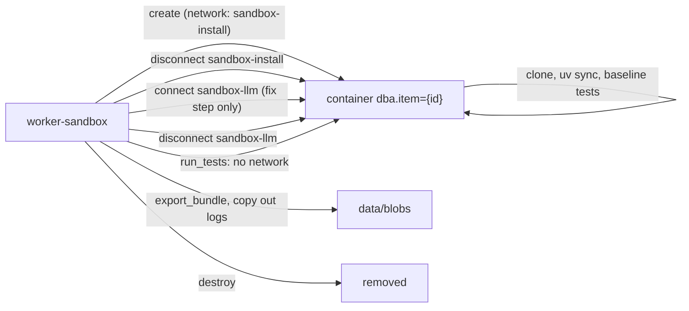

| Concern | Rule |
|---|---|
| Resources | `--cpus 2 --memory 4g --pids-limit 512` (laptop: `--cpus 1 --memory 2g`); read-only root FS except `/work`, `/tmp`, OpenCode/Entire state dirs |
| Networks | Default none. `sandbox-install` → egress-proxy allowlist: PyPI, files.pythonhosted.org, github.com (clone). `sandbox-llm` → `llm-gateway` only (`internal: true`, no internet) |
| Credentials | Clone: short-lived installation token used only for `git clone`, then removed from the remote URL. Fixer: per-attempt gateway token (section 19.5), passed as env to the `opencode run` exec only. No Bedrock, GitHub or Docker credentials ever enter a sandbox |
| Baseline | Baseline tests recorded; only new failures count |
| Cleanup | `finally` + janitor removes containers older than 1 h |
| Docker host | Uses the host's Docker through the mounted socket (works with Docker Desktop on macOS and Docker Engine on Linux) **[VERIFY Docker Desktop network connect/disconnect behaviour]** |
| Public mode | No install, no tests, no OpenCode; static analysis only |

---

## 19. Models (open-weight, served by Bedrock)

All model calls use open-weight models through Amazon Bedrock's OpenAI-compatible API. Model choice is configuration; every role can be swapped without code changes.

### 19.1 Model roles

| Role | Used by | Primary | Fallbacks |
|---|---|---|---|
| `orchestrator` | Coordinator LLM steps (grouping fallback, run report), Analyst loop, Verifier consistency check, cfo.ai sync agent | **GLM-5.3** on Bedrock (cross-Region inference profiles `us.zai.glm-5.3` / `global.zai.glm-5.3`) | GLM 5 on Bedrock (generally available); GLM-5.3 through Z.ai's or another provider's OpenAI-compatible API (outside Bedrock) |
| `coder` (open "Sonnet-class" model) | OpenCode fixer, in-house fallback fixer, `entire review` reviewers and judge, devbox OpenCode | Winner of the bake-off (19.6) among Bedrock open-weight coding models: **Kimi K2.5** (start default), MiniMax M2.5, Qwen3 Coder Next, DeepSeek V3.2, GLM 5 | GLM-5.3 (coding-focused, can serve both roles) |
| `light` | Changelog/advisory summaries, labels, short classifications | GLM 4.7 Flash | Qwen3 Coder Next |

Notes:
- **GLM-5.3 on Bedrock is limited to eligible customers** (access via the AWS account team) and is offered only through cross-Region inference profiles. Request access now; if it is not granted in time, `orchestrator` runs on GLM 5 on Bedrock with no code change **[VERIFY eligibility for your account]**.
- No open model is a guaranteed drop-in equivalent of Claude Sonnet. The `coder` role is chosen on dba's own eval set (19.6), and the choice is documented with traces.
- Bedrock's catalog changes quickly; confirm the exact model IDs and Regions in the console at kickoff **[VERIFY]**.

### 19.2 API and client

- **Endpoint:** Bedrock OpenAI-compatible Chat Completions API (`LLM_BASE_URL` in `.env`) **[VERIFY exact URL for your Region]**.
- **Auth:** Bedrock API key (`BEDROCK_API_KEY`), created once in the Bedrock console. No AWS SDK, no IAM code.
- **Client:** `openai` Python SDK (`AsyncOpenAI`), so the same code can point at any OpenAI-compatible provider (Z.ai, OpenRouter, a self-hosted vLLM) by changing `LLM_BASE_URL` and the key.
- **Tool use:** OpenAI function-calling format (`tools`, `tool_calls`, `role: "tool"` results). Output contracts (`submit_analysis`, `submit_verdict`) are functions with JSON Schemas.

```python
from openai import AsyncOpenAI
client = AsyncOpenAI(base_url=settings.llm_base_url, api_key=settings.bedrock_api_key)

resp = await client.chat.completions.create(
    model=settings.models.orchestrator,          # e.g. "us.zai.glm-5.3"
    messages=msgs,
    tools=tool_schemas,
    tool_choice="required",                      # the loop always expects an action
    temperature=0.2,
    max_tokens=4096,
)
```

All calls go through `backend/llm/provider.py` (`chat(role, messages, tools)`), which resolves the role to a model, applies role defaults (temperature, reasoning mode, context budget) and records usage.

### 19.3 Making open models reliable in the agent loop

| Risk | Mitigation |
|---|---|
| Malformed tool arguments | Validate with pydantic; on failure return a `role: "tool"` error message describing the schema violation; at most 2 repair turns, then `NEEDS_HUMAN` |
| Model answers in prose instead of calling a tool | `tool_choice: "required"`; final answers only via `submit_*` functions; one nudge |
| Too many tools confuse the model | ≤ 6 tools per agent role; descriptions short and concrete |
| Reasoning output mixed into history | Keep only assistant tool calls and tool results in history; store reasoning text, if returned separately, as a blob for traces **[VERIFY GLM reasoning field and on/off parameter]** |
| Long, costly context | Per-role context budget (orchestrator ≤ 128k tokens even when the model supports more); evidence passed as references and summaries |
| Non-determinism | Temperature 0.2 for orchestrator/coder, 0 for light; the deterministic decision table (section 10.2) stays the authority on verdicts |
| Repeated system prompts | Use Bedrock prompt caching where the model supports it (GLM-5.3 supports explicit caching on Bedrock) **[VERIFY request parameter]** |

### 19.4 Credentials
- `BEDROCK_API_KEY` and `LLM_BASE_URL` in `.env`; read by `worker-llm`, `worker-economics`, `llm-gateway` and `devbox` only. Never mounted into sandboxes or reviewer agent processes.
- Create the key with Bedrock invoke permissions only; rotate after the event.

### 19.5 `llm-gateway`

Sandboxes (untrusted code) and reviewer agents call models only through the gateway, which holds the Bedrock key and attributes every token to an item and attempt.

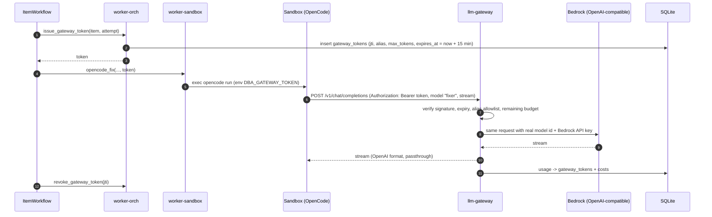

| Property | Rule |
|---|---|
| API | OpenAI-compatible `POST /v1/chat/completions` (streaming and non-streaming) and `GET /v1/models` (lists aliases only) |
| Aliases | `fixer`, `review` → mapped to the `coder` model id; `judge` → `coder` or `orchestrator` (config) |
| Auth | HMAC-signed bearer token (`GATEWAY_SIGNING_KEY`) with `jti`; checked against `gateway_tokens` |
| Limits | Alias allowlist per token; token budget per attempt; rejected once exceeded |
| Network | Reachable only on `sandbox-llm` and `app`; no published port |
| Usage | Per-request usage (incl. reasoning tokens if reported) → `costs` |
| Tracing | Each forwarded call is a neatlogs span tagged `item_id`, `attempt`, `model` |

**OpenCode config inside the sandbox** (OpenAI-compatible custom provider; no credentials in the file):
```json
{
  "$schema": "https://opencode.ai/config.json",
  "provider": {
    "dba": {
      "npm": "@ai-sdk/openai-compatible",
      "name": "dba gateway",
      "options": { "baseURL": "http://llm-gateway:8080/v1", "apiKey": "{env:DBA_GATEWAY_TOKEN}" },
      "models": { "fixer": { "name": "fixer" } }
    }
  },
  "model": "dba/fixer"
}
```
**[VERIFY key names against the pinned OpenCode version]**. Fallback if OpenCode cannot target the gateway: fixer mode `inhouse`.

### 19.6 Model bake-off (picks the `coder` model)

Runs on the eval harness (section 24) on Saturday evening with 8–10 cases, then the full set for the chosen model:

| Step | Detail |
|---|---|
| Candidates | `coder`: Kimi K2.5, MiniMax M2.5, Qwen3 Coder Next, GLM 5 (and GLM-5.3 if available). `orchestrator`: GLM-5.3 vs GLM 5 |
| Run | `EvalWorkflow` per candidate with `models.coder` / `models.orchestrator` overridden; traces tagged `model` |
| Metrics | Verdict accuracy, tests-green rate after fix, tool-call error rate, cost per item, time per item |
| Decision | Highest accuracy within the cost cap; tie → lower cost |
| Evidence | `results/model-bakeoff.md` + neatlogs Analytics grouped by `model` |

This doubles as judging evidence: the model choice is backed by traces and numbers.

### 19.7 Limits and cost
- Request Bedrock quota increases early; set `llm` queue `max_activities_per_second` and gateway concurrency below tokens-per-minute quotas.
- Cost = reported usage × price table in `config.toml` (per model id), from `worker-llm` and `llm-gateway`.
- **Confirm whether hackathon AWS credits cover third-party open-weight models on Bedrock** **[VERIFY]**.

---

## 20. neatlogs integration

- Every Python service: `neatlogs.init(workflow_name="dba", instrumentations=["openai"], mask=..., tags=...)` **before** importing `openai`. The OpenAI instrumentation records the Bedrock OpenAI-compatible calls; neatlogs may not know prices for these models, so dba also tags spans with its own computed `usd` and `model` **[VERIFY token capture]**.
- Activities carry `@span` (`AGENT` scope for loop drivers, `TOOL` for tools). Workflow code is not instrumented.
- Grouping: `session_id = run_id`; tags `run_id`, `item_id`, `package`, `prompt_label`, `mode`, `repo`. Cross-worker trace linking via Temporal OTel interceptor depends on neatlogs exposing its tracer provider **[VERIFY]**.
- OpenCode attempts: one `TOOL` span `opencode_fix` with brief, diff ref, tokens, Entire checkpoint id; transcript tail via `neatlogs.log()`.

| Feature | Use |
|---|---|
| Traces + Session Replay | Every run; demo shows a replay including a worker redeploy mid-run |
| Prompt management | `dba-analyst`, `dba-verifier`, `dba-fixer-brief`, `dba-report` with `v1` / `v2` / `production` |
| Code detections | `dismiss_without_evidence`, `fix_loop_exhausted`, `cost_spike`, `patch_guard_denied`, `opencode_timeout` |
| AI evaluators | Agent judge: does cited evidence support the verdict? |
| Analytics | Cost/latency by `prompt_label`, `package` |
| AI Search / Investigate | Cluster wrong verdicts |
| Send to IDE + MCP | Triage → your coding agent for the fix |

Pre-kickoff: `neatlogs doctor --probe --json`.

---

## 21. Entire integration overview

| Layer | What | Where |
|---|---|---|
| Build | Checkpoint every commit of the `dba` repo from OpenCode sessions | devbox (section 22.1) |
| Build | Graph guidance for your OpenCode sessions (`AGENTS.md`) | devbox |
| Runtime | `entire graph diff / impact / neighbors` | Sandbox |
| Runtime | **Fixer sessions captured as checkpoints** | Sandbox (section 22.2) |
| Runtime | `entire review` on patched branches | Review container (section 22.3) |
| Building in public | `entire dispatch` for update posts | devbox |
| Economics | `entire tokens` for build-time usage; cfo.ai sync sessions captured | devbox; `worker-economics` |
| Optional | Entire mirror as clone source; `entire-agent-dba` | — |

---

## 22. Using Entire with OpenCode (step by step)

Entire integrates with OpenCode through a TypeScript plugin installed by `entire agent add opencode` / `entire enable --agent opencode` (path `.opencode/plugins/entire.ts`). On turn-end it calls `opencode export` to capture the transcript; commits made during or after a session become checkpoints. OpenCode support is marked **preview** in Entire's agent list, so every step ends with a verification.

**Where checkpoints live.** Checkpoints are stored in your Git repository, not in an Entire service. Repositories enabled with CLI ≥ 0.10.0 use one ref per checkpoint (`refs/entire/checkpoints/<shard>/<id>`); the older single branch `entire/checkpoints/v1` is used only with `--checkpoint-backend branch`. Pushing happens through Git (Entire's pre-push hook, `push_sessions` default true). entire.io shows checkpoints for repositories the **Entire GitHub App** can read. Shadow branches (`entire/<commit>-<worktree>`) hold raw working-tree snapshots, stay local and must never be pushed.

### 22.0 Entire authentication from a remote server

**When login is needed.** Checkpoint capture, graph and checkpoint pushes run through local Git and need no Entire login; entire.io reads checkpoints through the Entire GitHub App. Login is needed for hosted features (account-level commands such as `activity`, mirrors, hosted search, possibly `dispatch`/`review` trail output) **[VERIFY per command at kickoff]**. dba logs in inside the devbox (your build sessions) and, only if `entire review` or `dispatch` require it, in `worker-review`. Sandboxes never log in.

**How remote login works.** `entire login` (same as `entire auth login`) starts an OAuth **device authorization flow**: it prints a device code and an approval URL; in non-interactive environments it does not try to open a browser, it just prints the URL. You approve on entire.io from any browser, the CLI receives a token and stores it for the current Entire API base URL. Management: `entire auth status`, `entire auth list`, `entire auth revoke --current`.

**Token storage on servers.** Desktop installs use the OS keyring. Third-party analysis of the CLI source reports a file-backed fallback and an `ENTIRE_TOKEN` environment variable for CI/headless use; this is not in the official docs **[VERIFY]**. dba therefore persists the CLI's config/token directory on `data/entire-auth` (mounted into devbox and `worker-review`) and, if `ENTIRE_TOKEN` is confirmed, keeps the token in `.env` instead.

**Web flow (no terminal):**

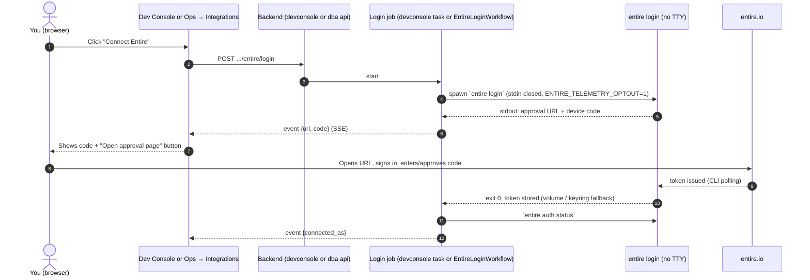

Implementation notes:
- Parse the URL with a regex for `https://…` and the code as the first line matching the device-code pattern; show raw stdout as a fallback.
- Timeout 15 min; on timeout kill the process and show "Expired, try again".
- For `worker-review` the job is the `entire_device_login` activity in `EntireLoginWorkflow` (review queue, `data/entire-auth` mounted at the CLI's config path), started from Ops → Integrations. In the devbox it is a background task in the Dev Console.
- "Disconnect" runs `entire auth revoke --current`.

### 22.1 devbox: build sessions from the browser

All commands below are executed by the devbox image/entrypoint or by Dev Console buttons.

| Step | Trigger | Runs | Verify in browser |
|---|---|---|---|
| 1. Tools installed | devbox image build | Entire install script; `entire plugin install graph`; OpenCode (pinned version) | Dev Console → Status shows `entire version`, `opencode --version` |
| 2. OpenCode on Bedrock | devbox entrypoint | Writes `opencode.json` (below); `LLM_BASE_URL` + `BEDROCK_API_KEY` from `.env` | Ask OpenCode Web "say hi" |
| 3. OpenCode Web up | devbox entrypoint | `opencode web --hostname 0.0.0.0 --port 4096` with `OPENCODE_SERVER_PASSWORD` | `http://localhost:4096` (laptop) or `https://dev.<domain>/` (server) loads |
| 4. Create repo | OpenCode Web: "create the dba repo skeleton, commit, push" (after kickoff) | `git init`, first commit, `git push` via credential helper | Repo visible on GitHub |
| 5. Enable Entire | Dev Console → "Enable Entire" | `entire enable --agent opencode --telemetry=false`; `entire status --detailed` | Status shows enabled; `.opencode/plugins/entire.ts` present |
| 6. Graph guidance | Dev Console → "Init graph" | `entire graph init-agents --repo .`; commit `AGENTS.md`, `.entire/`, `.opencode/` | Commit visible on GitHub |
| 7. Verify capture | OpenCode Web: make a small change and commit | Entire plugin captures on turn-end; checkpoint on commit | Dev Console → Checkpoints (`entire checkpoint list --json`) shows it; trailer `Entire-Checkpoint:` on the commit |
| 8. Push + view | OpenCode Web: "push" | `git push` (pre-push hook pushes checkpoint refs) | entire.io shows the session (Entire GitHub App installed on `hiten/dba`) |
| 9. Login (only if needed) | Dev Console → "Connect Entire" | Section 22.0 flow | Status shows connected account |

OpenCode config written by the devbox entrypoint:
```json
{
  "$schema": "https://opencode.ai/config.json",
  "provider": {
    "bedrock-oai": {
      "npm": "@ai-sdk/openai-compatible",
      "name": "Bedrock (OpenAI-compatible)",
      "options": { "baseURL": "{env:LLM_BASE_URL}", "apiKey": "{env:BEDROCK_API_KEY}" },
      "models": { "<coder-model-id>": { "name": "coder" }, "<orchestrator-model-id>": { "name": "orchestrator" } }
    }
  },
  "model": "bedrock-oai/<coder-model-id>"
}
```

Dev Console buttons and the commands behind them:

| Button | Command(s) |
|---|---|
| Status | `entire version`, `entire status --detailed`, `entire auth status`, `opencode --version` |
| Enable Entire | `entire enable --agent opencode --telemetry=false` |
| Init graph | `entire plugin install graph` (idempotent), `entire graph init-agents --repo .` |
| Checkpoints | `entire checkpoint list --json` |
| Doctor | `entire doctor` (output shown; any "fix" prompts answered no) |
| Test capture hook | `entire hooks opencode turn-end` (shows hook errors) |
| Connect / Disconnect Entire | Section 22.0 |
| Dispatch draft | `entire dispatch` → markdown shown for copying into an X post |

Notes:
- Entire captures sessions started through **OpenCode Web** the same way as TUI sessions only if the plugin runs in the web server process **[VERIFY at step 7 — first test on Saturday]**.
- Pin an OpenCode version whose web UI works in plain browser mode (a reported bug made buttons unresponsive in one version) and allow outbound HTTPS to `app.opencode.ai` (web UI assets are served from there).

### 22.2 Sandbox: fixer sessions captured at runtime

1. **Image** (built by GitHub Actions)
   ```dockerfile
   FROM python:3.12-slim
   ENV ENTIRE_TELEMETRY_OPTOUT=1
   RUN apt-get update && apt-get install -y git curl ca-certificates && rm -rf /var/lib/apt/lists/*
   RUN pip install uv
   RUN curl -fsSL https://entire.io/install.sh | bash && entire plugin install graph
   RUN curl -fsSL https://opencode.ai/install | bash          # pinned version [VERIFY]
   COPY docker/opencode/opencode.json /root/.config/opencode/opencode.json
   COPY docker/opencode/agents/dba-fixer.md /root/.config/opencode/agents/dba-fixer.md
   ```
2. **OpenCode config**: OpenAI-compatible custom provider pointing at `http://llm-gateway:8080/v1`, key from `DBA_GATEWAY_TOKEN`, model alias `fixer` (section 19.5); no credentials in the file.
3. **Fixer agent** (`agents/dba-fixer.md`): read `/work/.dba/brief.md`, change only application code, never edit tests/test config or dependency pins, stop when done. Permissions: file edits allowed, read-only shell, no network tools **[VERIFY permission keys]**. Patch guard still runs afterwards.
4. **Enable Entire per sandbox** (in `create_sandbox`, after clone; no login needed):
   ```bash
   cd /work/repo
   git config user.name "dba-bot" && git config user.email "dba-bot@users.noreply.github.com"
   entire enable --agent opencode --telemetry=false
   echo ".opencode/" >> .git/info/exclude
   ```
   The checkpoint remote is not configured inside the sandbox (it has no GitHub credentials); refs are exported in step 7.
5. **Run a fix attempt** (`opencode_fix`):
   ```bash
   docker network connect sandbox-llm <container>
   docker exec -e DBA_GATEWAY_TOKEN=<per-attempt token> \
     <container> sh -c 'cd /work/repo && timeout 480 opencode run --agent dba-fixer "Follow /work/.dba/brief.md"'
   docker network disconnect sandbox-llm <container>
   ```
   Headless `opencode run` must trigger the plugin's turn-end hook **[VERIFY — Saturday go/no-go]**.
6. **Commit and checkpoint** (harness, after patch guard allows): `git add -A && git commit -m "dba: fix attempt n for <pkg> <from>-><to>"`; read the checkpoint id from the commit's `Entire-Checkpoint:` trailer; store in `fix_attempts.entire_checkpoint_id`.
7. **Export checkpoints**: `export_bundle` runs `git bundle create out.bundle HEAD 'refs/entire/checkpoints/*'` (never shadow branches); `export_checkpoints` (github worker) fetches the bundle and pushes `refs/entire/checkpoints/*:refs/entire/checkpoints/*` to `hiten/dba-checkpoints` with a token scoped to that repo.
8. **Surface it**: item detail links each fix attempt to its checkpoint on entire.io.

**If step 5 does not create checkpoints headlessly:** keep OpenCode as fixer, store its `opencode export` transcript as a blob, and rely on build-time checkpoints for Entire evidence. If OpenCode is unreliable headless, set `fixer.mode = "inhouse"` (section 8.2).

### 22.3 Review container: `entire review`

1. Image: worker base + Entire CLI + OpenCode (gateway provider config with aliases `review` and `judge`), `ENTIRE_TELEMETRY_OPTOUT=1`; `data/entire-auth` mounted only if login is required.
2. Profile configured at container start (non-interactive):
   ```bash
   entire review --agents
   entire review --configure --set-agents opencode,opencode --set-judge opencode --set-output local
   # per-reviewer models (aliases resolved by llm-gateway), if supported:
   # entire review --configure --set-slot opencode=dba/review --set-slot opencode=dba/review-alt --set-judge opencode=dba/judge
   ```
   The Ops → Integrations page shows the configured profile and the available reviewer list.
3. Per item: unpack the bundle, check out `dba/item-{id}`, run `entire review general --base <base_sha> --prompt "<verdict + evidence summary>" --timeout 8m`, parse findings, store as blob.
4. Credentials: reviewer agents use `llm-gateway` (per-review token); no Bedrock, GitHub or Docker credentials in the container's agent processes.

### 22.4 Troubleshooting (all from Dev Console or Ops)

| Symptom | Check (button) | Likely fix |
|---|---|---|
| No checkpoint after commit | Status, Test capture hook | Plugin file missing → Enable Entire again; `opencode export` failing → OpenCode version |
| Checkpoint local but not on entire.io | Checkpoints; GitHub repo refs | Entire GitHub App not installed on the repo; push did not include checkpoint refs |
| Login stuck | Integrations → Entire | Code expired (15 min) → reconnect |
| `entire` asks for consent / hangs in a job | Job output | `--telemetry=false` / `ENTIRE_TELEMETRY_OPTOUT=1` missing |
| Review fails | Integrations → review profile | Reviewer agent unsupported → disable review (in-house consistency check remains) |

---

## 23. cfo.ai

The economics update runs on AWS as a workflow, so the business model refreshes after every eval without anyone at a laptop.

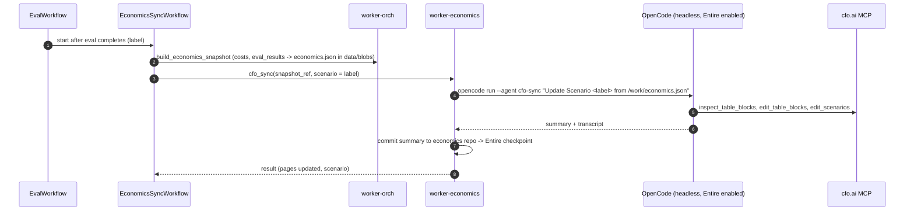

| Step | Detail |
|---|---|
| One-time setup | Ops → Integrations → "Connect cfo.ai": the economics worker temporarily serves OpenCode Web on an admin-only route; you add the cfo.ai MCP server there and complete its OAuth in the browser; OpenCode's auth/state directory stays on an encrypted volume **[VERIFY MCP OAuth works through OpenCode Web on a server]** |
| Agent | `cfo-sync` OpenCode agent: may only call cfo.ai MCP tools and read `/work/economics.json`; writes only to a Scenario named after the prompt label, never to Main without approval |
| Model contents | Price per repo/month, PRs per repo/month, measured Bedrock cost per PR (in-house + OpenCode), server fixed cost, engineer time saved per PR, margin, revenue scenarios, runway |
| Evidence | cfo.ai shared read-only Page link; Entire checkpoint of each sync session; neatlogs span `cfo_sync` |
| Fallback | If headless OAuth does not persist: open Ari in a browser and attach `economics.csv` downloaded from the Admin page |

---

## 24. Evaluation and improvement

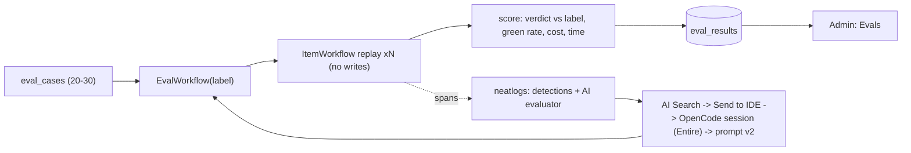

Labels: merged untouched → `MERGE`; merged after human code commits → `FIX_THEN_MERGE`; closed with stated reason → `DISMISS`; superseded/unexplained excluded; UI overrides added. Metrics: accuracy + confusion matrix, green rate, `NEEDS_HUMAN` rate, cost/item, time/item, fix attempts.

---

## 25. Failure handling

| Failure | Handling | Result |
|---|---|---|
| Worker crash / redeploy | Temporal reschedules; replay | No lost work |
| Laptop sleeps (laptop mode) | Stack pauses; Temporal resumes everything on wake | Runs continue later; use a server for unattended runs |
| Entire token expired/revoked | Integrations shows "not connected"; hosted-only steps skipped | Reconnect via device flow; capture unaffected |
| cfo.ai MCP token expired | `cfo_sync` fails non-retryably; event `cfo_auth_required` | Re-auth once; or manual Ari fallback |
| Rebuild/restart during a run (`compose up -d --build`) | Temporal resumes in-flight workflows | No lost work |
| Google sign-in fails (redirect URI mismatch, consent screen in Testing without your account) | oauth2-proxy logs; fix the Google client settings | Temporal UI unavailable until fixed; workflows unaffected |
| SQLite `database is locked` | `busy_timeout` 5 s + retry with jitter in writers | Delayed write, no loss |
| Bedrock throttling | `llm_call` retries + queue rate limit; OpenCode attempt retried once | Delayed |
| Bedrock access denied / wrong model id | Non-retryable; run fails fast with clear event | Config fix |
| Gateway token expired/over budget mid-attempt | Gateway rejects; attempt fails cleanly | Next attempt gets a new token, or `NEEDS_HUMAN / BUDGET` |
| OpenCode hangs | Heartbeat timeout + `timeout 480` inside exec | Attempt fails; next attempt or `NEEDS_HUMAN` |
| OpenCode edits tests / pins back | Patch guard deny → reset | Counts as attempt |
| Entire checkpoint not created | Attempt continues; transcript stored as blob; event `checkpoint_missing` | Evidence still present |
| GitHub limits / 5xx | Retries + queue limit | Delayed |
| Package source unavailable | wheel → sdist; else changelog-only analysis | Confidence ≤ 0.5 |
| Resolution failure | One `--refresh` retry, one fix attempt | `NEEDS_HUMAN / RESOLUTION_FAILURE` |
| Baseline already red | Compare new failures only | — |
| Flaky test | One rerun | Recorded |
| Budget exhausted | Forced verdict | `NEEDS_HUMAN / BUDGET` |
| `entire review` failure | In-house check fallback | Recorded |
| Integration conflict | Bisect | `NEEDS_HUMAN / INTERACTION_FAILURE` |
| PR head changed | Action validator | Action cancelled, item re-queued |
| Browser reconnect | SSE backfill | No missed events |

---

## 26. Security

1. Writes only via the GitHub App to installed repos (activity layer).
2. Patch guard on every diff (section 8.4).
3. Sandboxes hold no Bedrock, GitHub or Docker credentials; model access only through `llm-gateway` with per-attempt, budgeted, short-lived tokens.
4. Sandbox networks: none by default; `sandbox-install` (allowlisted proxy) during install; `sandbox-llm` (gateway only, no internet) during fix steps.
5. Secrets live in `.env` and `secrets/` (both gitignored, file mode 600); only the services that need a secret receive it via `env_file`/variables in compose.
6. Bedrock credential limited to Bedrock invoke on chosen models (created once in the AWS Console); rotated after the event.
7. Untrusted text fenced in prompts; `entire investigate` with untrusted seeds not used.
8. Reachable/uncertain security fixes never dismissed.
9. Public mode never executes repo code.
10. Webhook signatures verified; workflow IDs deduplicate.
11. neatlogs `mask=` strips tokens and credentialed URLs; Entire redacts detected secrets in checkpoints.
12. Laptop: all published ports bound to `127.0.0.1` (Caddy `8080`, OpenCode Web `4096`, Temporal UI `8233`). Server: only Caddy publishes ports; `/devbox-api` and `/admin/*` require admin; `dev.` behind basic auth; `temporal.` behind Google sign-in (oauth2-proxy, email allowlist, 12 h secure cookie); Temporal gRPC never published; OpenCode Web also requires `OPENCODE_SERVER_PASSWORD`; SQLite files never exposed.
13. Entire tokens only in `data/entire-auth` (devbox and, if needed, `worker-review`); never in sandboxes. Checkpoint repos private; shadow branches never exported.
14. Single-host caveat: see section 3.8; run the devbox elsewhere for anything beyond the hackathon.

---

## 27. Repo layout

```
dba/
├── README.md · hackathon.md · business-plan/
├── docker-compose.yml             # all services incl. caddy; laptop default
├── compose.server.yml             # Caddyfile.server, restart policies
├── compose.dev.yml                # next dev with hot reload for web
├── Caddyfile.local · Caddyfile.server
├── .env.example · config.toml
├── secrets/                       # gitignored: github-app.pem, temporal-allowed-emails.txt
├── data/                          # gitignored: dba.sqlite3, temporal/, blobs/, workspace/, entire-auth/, opencode-*/
├── AGENTS.md                      # Entire graph guidance (generated)
├── .opencode/plugins/entire.ts    # installed by entire enable
├── backend/
│   ├── api/                       # routes, auth, sse, webhooks, ops/admin
│   ├── temporal/
│   │   ├── workflows/             # backlog_run, item, actions, pr_watch, eval, public, economics_sync, entire_login
│   │   ├── activities/            # github, sandbox, llm, opencode, graph, ast_usage, advisories,
│   │   │                          # verify, review, gateway_tokens, events, report, economics
│   │   └── worker.py              # --queue orch|llm|sandbox|github|review|economics
│   ├── gateway/                   # llm-gateway (OpenAI-compatible proxy to Bedrock, aliases, budgets)
│   ├── llm/                       # provider.py: role → model, AsyncOpenAI client, usage + pricing
│   ├── harness/                   # context builder, tool registry, budgets, contracts, fix brief
│   ├── core/                      # decision.py, patch_guard.py, planning.py (pure)
│   ├── db/                        # SQLAlchemy models, Alembic migrations (batch mode)
│   └── tracing.py                 # neatlogs.init (imported first)
├── web/                           # Next.js App Router (TypeScript)
│   ├── app/                       # routes from section 16.4, each with loading.tsx / error.tsx; template.tsx for route transitions
│   ├── components/ui/             # shadcn CLI output (only variants added)
│   ├── components/composed/       # section 16.5.2, shadcn-only compositions
│   ├── components/custom/         # empty unless justified in 16.5.3
│   ├── lib/                       # api client, query keys, useRunEvents (SSE), motion presets, utils (cn)
│   ├── components.json            # shadcn config
│   └── app/globals.css            # Tailwind + shadcn theme tokens + tw-animate-css
├── devconsole/                    # devconsole JSON API (runs in devbox); UI lives in web/app/admin/devconsole
├── docker/
│   ├── Dockerfile.app · Dockerfile.web · Dockerfile.sandbox · Dockerfile.review · Dockerfile.devbox
│   ├── opencode/                  # sandbox, devbox, economics configs; agents/dba-fixer.md, agents/cfo-sync.md
│   └── egress-proxy/              # allowlist
├── scripts/backup.sh              # SQLite online backup + data/ archive
├── .github/workflows/ci.yml       # lint, tests, image build
├── .github/workflows/deploy-ssh.yml   # optional: ssh host "git pull && docker compose up -d --build"
├── dataset/cases/*.yaml
└── results/
```

---

## 28. Evidence map

| Judging need | Evidence |
|---|---|
| Agent completes substantial task | Run board on demo repo: N → 0; public report |
| neatlogs used | Session links, Session Replay, detections, evaluator scores, v1/v2 Analytics |
| Agent improved | v1 vs v2 eval with trace links |
| Recovery | FAIL → OpenCode fix → PASS item; worker redeployed mid-run, run completes |
| Entire used | Build checkpoints; **fixer-session checkpoints linked from each fix**; graph evidence; review results |
| cfo.ai used | Shared Page link + export |
| Building in public | #neatHack posts drafted with `entire dispatch` |
| Code during event | Commit history from 10 Oct 12:30 IST |

| | neatlogs | Entire | cfo.ai |
|---|---|---|---|
| Architecture | Spans per activity; session per run | Graph in analysis; checkpoints on fixer sessions; review in verifier | Export → MCP → Model |
| Implementation | `tracing.py`, prompt labels, detections | Sandbox image, `opencode_fix`, `graph.py`, `review.py` | Economics export |
| Runtime | Session Replay of a live run | Item card → fixer checkpoint on entire.io | Model refreshed from run data |
| Reasoning | Detection + evaluator caught a bad verdict | Why unreachable; fixer transcript | Pricing choice |
| Result | v1 → v2 metrics | Checkpoint of the improving commit | Margin, runway, shared Page |

---

## 29. Build order

| Block | Window (IST) | Deliverable | Done when |
|---|---|---|---|
| Pre | Fri (no code) | Google OAuth client for Temporal UI (redirect URIs for server + localhost:8234); Bedrock model access, quota request, Bedrock-only credential; credit coverage question; GitHub App registered (localhost + server callback URLs); Entire GitHub App installed; demo repo; server with Docker + DNS (for Sunday) | Credentials ready; Docker running on laptop |
| B0 | Sat 12:30–14:00 | Compose skeleton (caddy, web, api, temporal, one worker, devbox) on the laptop; Next.js + shadcn init, theme tokens, `AppShell`, motion presets; Dev Console page; section 22.1 steps 4–8; Ops page with Bedrock test traced in neatlogs | `localhost:8080` shows the shell; checkpoint on entire.io; trace in neatlogs |
| B1 | Sat 14:00–16:00 | Temporal hello-world; GitHub App auth; ingest; sandbox with baseline; events + SSE; bare board | Cards appear for real backlog |
| — | Sat 16:00 | **Go/no-go:** Temporal, and OpenCode headless + Entire capture in sandbox (22.2 step 5) | Decisions recorded |
| B2 | Sat 16:00–21:00 | ItemWorkflow: apply, tests, OpenCode fixer, guard, commit, checkpoint export | FAIL → fix → PASS with checkpoint link |
| B3 | Sat 21:00–24:00 | Concurrency, pause/resume/cancel, restart-mid-run test; `llm-gateway` | Run survives `compose up -d --build` |
| B4 | Sun 08:00–12:00 | Graph diff, AST, impact, decision table, Analyst loop, item detail | Reachability evidence on cards |
| B5 | Sun 12:00–15:00 | Verifier + `entire review`; action levels 1, 2, 5; approvals | Approved merge on demo repo |
| B6 | Sun 15:00–19:00 | Dataset, EvalWorkflow, detections, evaluator, v1 → v2 | Two scored eval runs |
| B6.5 | Sun 15:00 (parallel) | Same compose on the server with `compose.server.yml`, incl. oauth2-proxy | Server URL works with TLS; `temporal.<domain>` requires Google sign-in and rejects a non-listed account |
| B7 | Sun 19:00–23:00 | `EconomicsSyncWorkflow` + cfo.ai MCP, report + share, integration pass | Scenario updated automatically after eval; shared Page + public report |
| B7.5 | Sun 23:00–Mon 01:00 | UX pass: section 16.9 checklist, Laws of UX table walk-through per screen, reduced-motion and dark mode check | Checklist green |
| B8 | Mon 09:00–18:00 | README, `hackathon.md`, video (backup recording) | Submission ready |
| — | Mon 19:00 | Submit early | Quote post live |

**UI cut order (if behind):** charts on Report/Evals (tables only) → split diff view (unified only) → number tweens → list presence animations. Never cut: board card transitions, loading/empty/error states, overlay animations (built into shadcn).
**Cut order:** continuous mode → action levels 3–4 → public mode → integration pass → `entire review` (keep in-house check) → AI evaluator (keep detections) → OpenCode fixer (switch to in-house fixer; keep Entire on build sessions).
**Never cut:** neatlogs tracing, Entire checkpoints (build), graph evidence, v1/v2 eval, cfo.ai plan, run board, server deployment for the demo.
**If `llm-gateway` + OpenCode provider wiring fails:** fixer mode `inhouse` (gateway not needed).
**If cfo.ai headless OAuth fails:** keep the Admin export and update the model through Ari in a browser.

---

## 30. Configuration

Secrets and machine-specific values: `.env` (section 3.2). Behaviour: `config.toml`.

```toml
[database]
url_env = "DATABASE_URL"            # sqlite+aiosqlite:////data/dba.sqlite3

[llm]
base_url_env = "LLM_BASE_URL"
api_key_env = "BEDROCK_API_KEY"
[llm.models]
orchestrator = "us.zai.glm-5.3"          # fallback: GLM 5 id on Bedrock
coder        = "<winner of bake-off, start: Kimi K2.5 id>"
light        = "<GLM 4.7 Flash id>"
[llm.roles.orchestrator]
temperature = 0.2
max_context_tokens = 128000
reasoning = "on"                         # provider-specific parameter [VERIFY]
[llm.roles.coder]
temperature = 0.2
[llm.roles.light]
temperature = 0.0

[gateway]
url = "http://llm-gateway:8080"
token_ttl_s = 900
[gateway.aliases]
fixer      = "coder"
review     = "coder"
review-alt = "orchestrator"
judge      = "orchestrator"
[gateway.budgets]
fixer_max_tokens = 400000
review_max_tokens = 300000

[fixer]
mode = "opencode"                   # or "inhouse"
attempt_timeout_s = 480
max_attempts = 3

[review]
enabled = true
profile = "general"
timeout = "8m"

[entire]
checkpoint_repo_env = "CHECKPOINT_REPO"

[sandbox]
image = "dba-sandbox:latest"
cpus = 2                             # laptop: 1
memory = "4g"                        # laptop: "2g"

[limits]
concurrency = 3                      # laptop: 1
llm_rps = 2
item_usd_cap = 1.50

[actions]
default_level = 1
approval_timeout_h = 24

[pricing]                            # USD per 1M tokens, per model id
```

---

## 31. Open items to verify at kickoff

| # | Item | Check | Fallback |
|---|---|---|---|
| 1 | Headless `opencode run` triggers Entire capture | 22.2 step 5 in a test container | Store `opencode export` transcript; Entire on build sessions only |
| 2 | `entire enable --agent opencode` with `--checkpoint-remote` non-interactively | Run in container | Default remote + push ref via `export_checkpoints` |
| 3 | `entire review` supports OpenCode reviewers/judge with per-slot models | `entire review --agents` | In-house consistency check |
| 4 | Entire login needed for capture/review | Run without login | `entire login` once, config on volume |
| 5 | OpenCode install command, permission keys, remote MCP config | OpenCode docs | Adjust image/config |
| 6 | Sandbox install steps work through the egress proxy (`uv`, `pip download`, `git clone`) | B1 | Wider allowlist |
| 7 | OpenCode token usage source | Gateway usage records (primary) | `opencode export` JSON / Entire token data |
| 8 | Bedrock model/inference-profile IDs and region access | Bedrock console | Different region / profile |
| 9 | Bedrock quotas | Service Quotas | Lower concurrency; request increase |
| 10 | Hackathon AWS credits cover third-party open-weight models on Bedrock | Ask in Discord | Budget from own account |
| 11 | neatlogs `openai` instrumentation captures Bedrock OpenAI-compatible calls with tokens | One traced call | Manual span with usage attrs |
| 12 | neatlogs tracer provider with Temporal OTel interceptor | SDK / Discord | Session + tags grouping |
| 13 | neatlogs AI evaluators auto-run by filter | Dashboard | Manual run on eval traces |
| 14 | `entire graph diff` args; edges into third-party code; Python coverage | `entire graph help diff`, `neighbors`, `capabilities --json` | AST-only paths |
| 15 | GitHub App access to advisories | Permission list | GHSA global API + OSV |
| 16 | Dependabot PR speed on new demo repo | Create Saturday morning | Agent-created bump PRs |
| 17 | Temporal dev server (SQLite) stable in compose on laptop and server | B0 | DBOS / asyncio + SQLite jobs |
| 18 | OSS tools as dependencies allowed | Discord | Own implementations |
| 19 | cfo.ai MCP OAuth from a headless OpenCode; token persistence and refresh | One-time setup in `worker-economics` | Manual Ari fallback |
| 20 | OpenCode OpenAI-compatible provider works against the Bedrock endpoint (devbox, economics) | "say hi" in OpenCode Web | OpenCode `amazon-bedrock` provider with the open model id |
| 21 | OpenCode custom provider targets `llm-gateway` (`baseURL`, key from env, alias model) | One `opencode run` in a sandbox | Fixer mode `inhouse` |
| 22 | Which Entire commands need login (`review`, `dispatch`, search) | Run each without login | Device login via Dev Console / Ops |
| 23 | Entire token storage in a keyring-less container; `ENTIRE_TOKEN` support | Login in container, restart, `entire auth status` | Persist config dir on `data/entire-auth` |
| 24 | `entire login` stdout format without a TTY (URL + code parsing) | Run in Dev Console | Show raw output in the page |
| 25 | Entire captures OpenCode **Web** sessions | 22.1 step 7 | Capture via `opencode run` from Dev Console |
| 26 | OpenCode version with working browser web UI | Pin and test | Older/newer pinned version |
| 27 | Checkpoint refspec push to separate repo is shown on entire.io | 22.2 step 7 + entire.io | Branch backend (`--checkpoint-backend branch`) |
| 28 | SQLite write contention with 7 processes under load | Eval run with concurrency 3 | Fewer writers (route event writes through `worker-orch`), or Postgres via `DATABASE_URL` |
| 29 | Gateway streaming compatibility with OpenCode and `entire review` agents | First fix attempt + first review | Non-streaming mode; direct-credential fallback |
| 30 | Docker Desktop (macOS) supports runtime `network connect/disconnect` for sandboxes and arm64 builds of OpenCode/Entire | Laptop B1 | Linux VM / test on server |
| 31 | shadcn CLI default primitives (Base UI vs Radix) and exact component names (Toast, Item, Empty, Field) in the version installed | `npx shadcn@latest add …` at B0 | Use the variant the CLI installs; adjust composed components |
| 32 | `motion` layout animations inside Next.js client components with React Server Components boundaries | B1 board prototype | CSS-only transitions (fade between columns) |
| 33 | SSE through Caddy without buffering (`flush_interval -1`) | B1 | Long-poll fallback endpoint |
| 34 | Intercepting + parallel routes for the item Sheet behave with Back/forward and deep links | B4 | Query-param controlled Sheet |
| 35 | oauth2-proxy image tag and env var names for the pinned version | B6.5 | Equivalent command-line flags |
| 36 | Temporal UI works behind oauth2-proxy at the domain root (assets, API calls, cookies) | B6.5 | Temporal UI built-in OIDC |
| 37 | GLM-5.3 Bedrock access for your account (eligible customers only) | Request via AWS account team now | GLM 5 on Bedrock as `orchestrator` |
| 38 | Bedrock OpenAI-compatible endpoint URL, API key type, and which open models it serves in your Region | Bedrock console + one call per role | Converse API adapter in `provider.py` |
| 39 | Tool-calling reliability of each candidate (tool-call error rate) | Bake-off (19.6) | Drop candidate; reduce tools per role |
| 40 | Reasoning/thinking parameter and response field for GLM on Bedrock | One call with reasoning on | Run without reasoning mode |